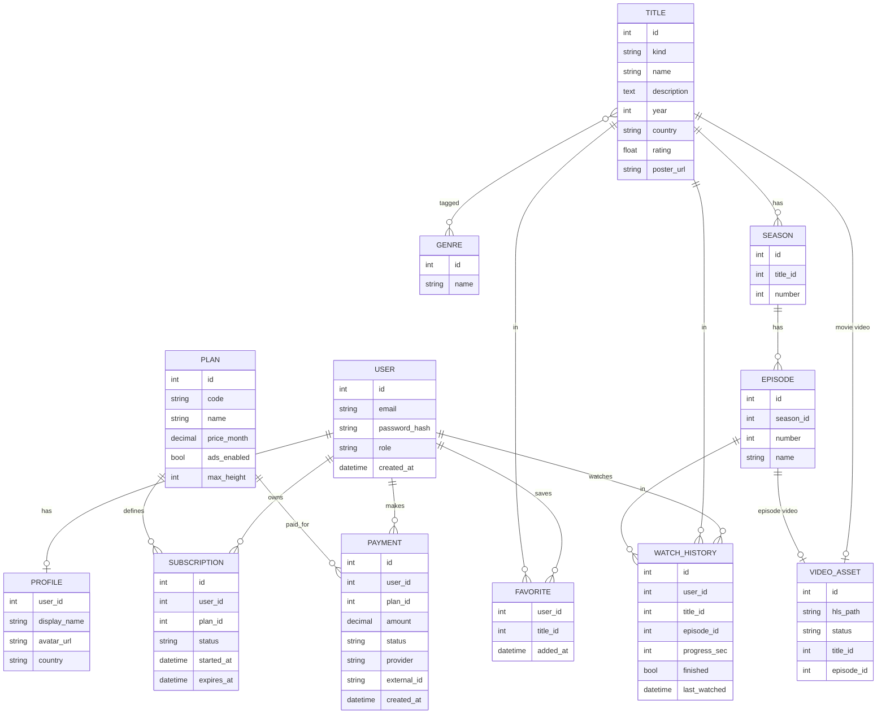

# Архітектура Cinema Platform

## 1. Актори і Use Cases


Примітка: Користувач наслідує можливості Гостя, Преміум-користувач — Користувача.

## 2. Модель даних (ER)



Плани створюються сідом (`python -m app.seed`): `free` (реклама, до 720p, 0 грн) і `premium` (без реклами, до 1080p,
99 грн/міс). Користувач без активної `SUBSCRIPTION` вважається на плані `free`, тому окремий запис підписки для Free
не створюється. Сід також створює адміністратора з `ADMIN_EMAIL` / `ADMIN_PASSWORD`.

`python -m app.seed --demo` додатково завантажує демо-каталог (`app/demo_data.py`): 12 жанрів, 25 фільмів і 6 серіалів
із сезонами та епізодами. Повторний запуск не створює дублікатів: тайтл шукається за (kind, name, year), довідкові
поля відновлюються, а постер, перейменовані епізоди й додані адміністратором сезони зберігаються.

Цілісність каталогу: номер сезону унікальний у межах тайтлу, номер епізоду — у межах сезону (унікальні обмеження в БД
плюс перевірка в `AdminCatalogService` з кодом 409). Сезони додаються лише до серіалів. Видалення тайтлу каскадно
прибирає сезони, епізоди, зв'язки з жанрами, відео, «Вибране», історію переглядів і файл постера. Постери зберігаються
в `media/posters/` через абстракцію `FileStorage` (`LocalMediaStorage`) і роздаються за адресою `/media/...`.

## 3. Патерни і взаємодія

```
Router ──> PlaybackService ──> PlaybackProxy ──> (RealPlayback) HLS manifest
                                   │  перевіряє SubscriptionPlan (Factory Method → PlanPolicy)
                                   └─ повертає: дозволені якості, прапорець реклами
Router ──> CatalogService ──> TitleQueryBuilder ──> TitleRepository
Router ──> RecommendationService ──> RecommendationStrategy (Genre | Popularity | Hybrid)
Router ──> BillingService ──> PaymentGateway (Adapter → MockGateway: success/pending/failed)
                    │ успіх
                    └─> EventBus.publish(PaymentSucceeded) ──> SubscriptionActivator (Observer)
PlaybackService ──> EventBus.publish(WatchFinished) ──> StatsUpdater (Observer)
Reports: ReportGenerator (Template Method) ──> PopularTitles | UserActivity | Revenue
```

Як патерни працюють разом: проксі отримує політику від фабрики, платіж через адаптер породжує подію, яку обробляють
спостерігачі (активація підписки), після чого проксі вже пускає користувача без реклами.

GRASP: Controller (роутери), Information Expert (політика плану знає про рекламу і якість), Low Coupling / High Cohesion
(шари), Polymorphism (стратегії, шлюзи), Pure Fabrication (EventBus), Protected Variations (інтерфейс шлюзу).

## 4. Оплата (mock)

1. `POST /billing/checkout {plan_code}` → створює `Payment(status=created)`, повертає `payment_id`.
2. UI показує сторінку оплати з вибором результату: **success / pending / failed**.
3. `POST /billing/payments/{id}/mock-result {outcome}` → MockGateway повертає результат:
   - success → `Payment=success`, подія `PaymentSucceeded`, підписка Premium активна на 30 днів;
   - pending → `Payment=pending`, підписка не змінюється; адмін або користувач може пізніше «підтвердити» (повторний виклик);
   - failed → `Payment=failed`, підписка не змінюється.

## 5. HLS

Для кожного відео: `ffmpeg` → `media/<asset_id>/{360p,720p,1080p}/index.m3u8` + `master.m3u8`.
Бекенд віддає `master.m3u8` через проксі: Free бачить до 720p і рекламу перед фільмом, Premium — до 1080p без реклами.

## 6. План на 7 днів

| День | Дата | Результат |
|---|---|---|
| 1 | сб 21.11 | Репозиторій, compose, моделі, Alembic, auth (реєстрація/вхід/JWT), каркас React |
| 2 | нд 22.11 | Каталог, пошук/фільтри (Builder), адмін CRUD для фільмів/жанрів |
| 3 | пн 23.11 | ffmpeg → HLS, плеєр, Playback Proxy, Вибране, історія переглядів |
| 4 | вт 24.11 | Плани, Factory Method, оплата (Adapter + mock UI), EventBus (Observer) |
| 5 | ср 25.11 | Рекомендації (Strategy), звіти (Template Method), адмін-дашборд |
| 6 | чт 26.11 | Тести, полірування UI, UML (Use Case, класи з кольорами патернів), скріни |
| 7 | пт 27.11 | Звіт, README, фінальний прогін розгортання з нуля, запас часу |
