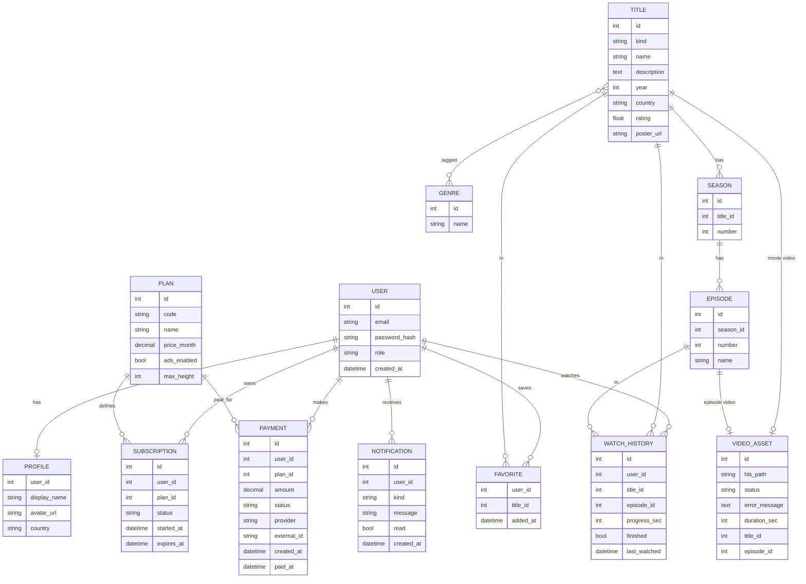
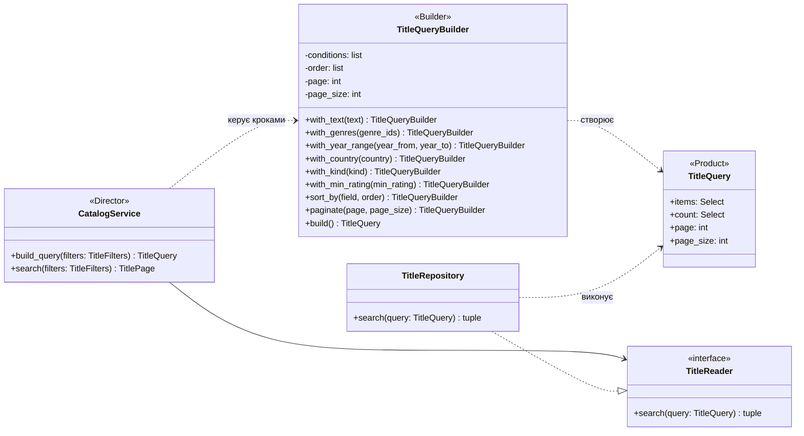
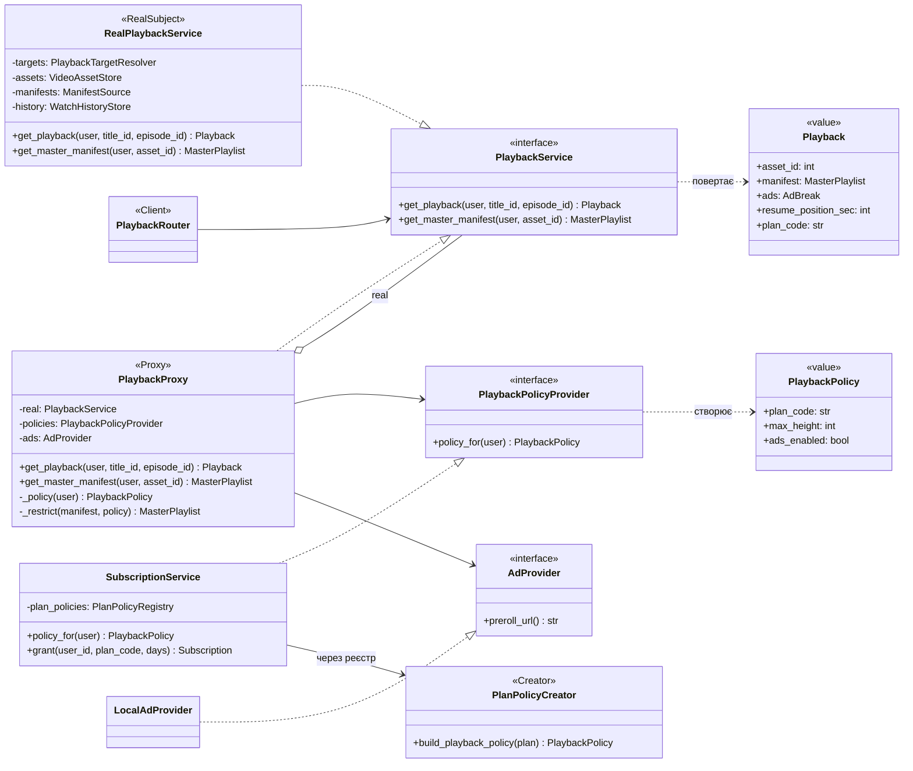
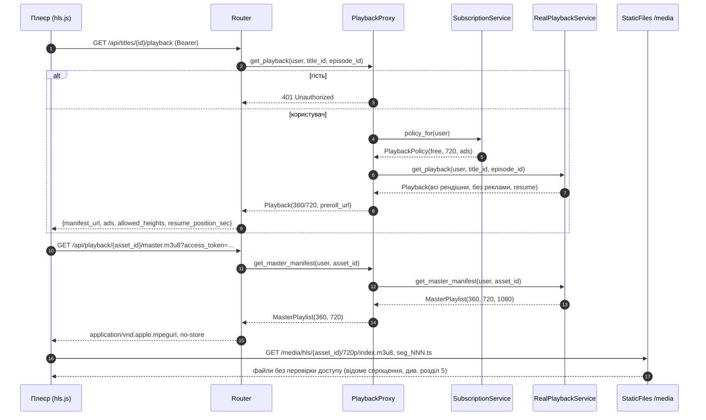
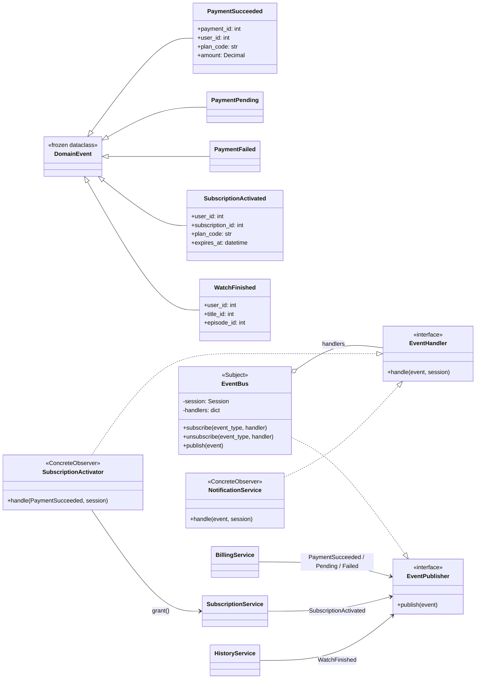
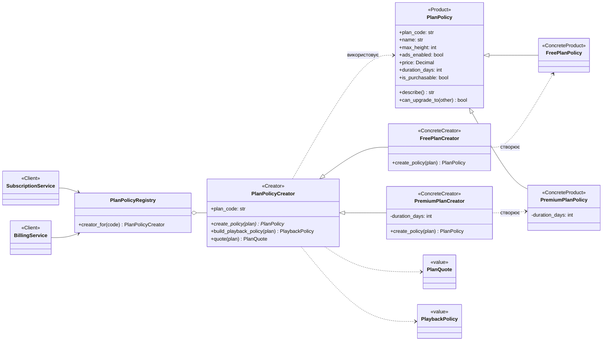
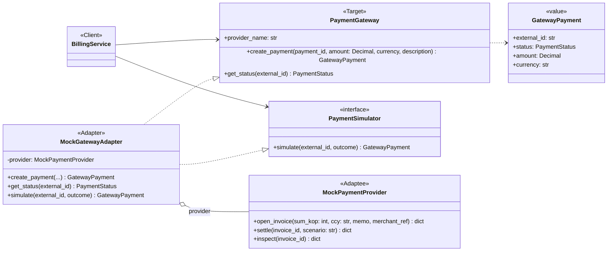
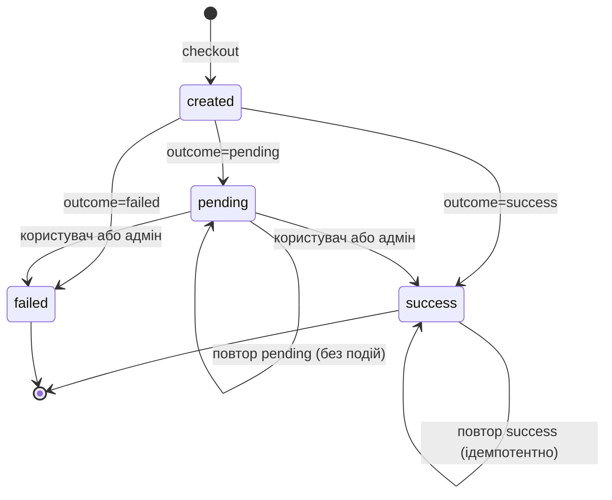
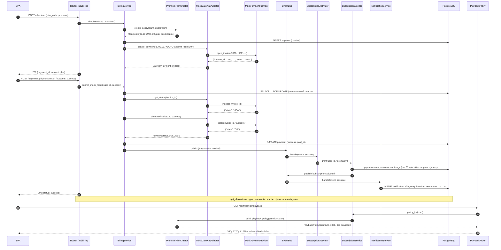

# Архітектура Cinema Platform

## 1. Актори і Use Cases


Примітка: Користувач наслідує можливості Гостя, Преміум-користувач — Користувача.

## 2. Модель даних (ER)



Плани створюються сідом (`python -m app.seed`): `free` (реклама, до 720p, 0 грн) і `premium` (без реклами, до 1080p,
99 грн/міс). Користувач без активної `SUBSCRIPTION` вважається на плані `free`, тому окремий запис підписки для Free
не створюється. Сід також створює адміністратора з `ADMIN_EMAIL` / `ADMIN_PASSWORD`.

**Підписки, платежі, сповіщення.**
- `SUBSCRIPTION.status`: `active`; `cancelled` (користувач скасував, доступ діє до `expires_at`); `expired` (адміністратор
  забрав Premium або підписку замінено іншим планом). Активною вважається підписка зі статусом `active` або `cancelled`
  і `expires_at` у майбутньому.
- `PAYMENT.status`: `created → pending → success | failed`, або одразу `created → success | failed`. `success` і
  `failed` фінальні. `external_id` — номер invoice у платіжного провайдера, `paid_at` заповнюється лише при `success`
  (знадобиться звіту доходів). Індекс `(status, created_at)` обслуговує адмін-список із фільтром за статусом.
- `NOTIFICATION.kind`: `payment_pending`, `payment_failed`, `subscription_activated`. Індекс `(user_id, created_at)`
  обслуговує стрічку сповіщень користувача.

`python -m app.seed --demo` додатково завантажує демо-каталог (`app/demo_data.py`): 12 жанрів, 25 фільмів і 6 серіалів
із сезонами та епізодами. Повторний запуск не створює дублікатів: тайтл шукається за (kind, name, year), довідкові
поля відновлюються, а постер, перейменовані епізоди й додані адміністратором сезони зберігаються.

Цілісність каталогу: номер сезону унікальний у межах тайтлу, номер епізоду — у межах сезону (унікальні обмеження в БД
плюс перевірка в `AdminCatalogService` з кодом 409). Сезони додаються лише до серіалів. Видалення тайтлу каскадно
прибирає сезони, епізоди, зв'язки з жанрами, відео, «Вибране», історію переглядів і файл постера. Постери зберігаються
в `media/posters/` через абстракцію `FileStorage` (`LocalMediaStorage`) і роздаються за адресою `/media/...`.

**Вибране та історія переглядів.**
- `FAVORITE` має складений первинний ключ (користувач, тайтл), тому `POST /api/favorites/{title_id}` ідемпотентний
  (`INSERT … ON CONFLICT DO NOTHING`, 204), як і `DELETE` (204 навіть для відсутнього запису).
- `GET /api/favorites` повертає ті самі картки `TitlePage`, що й каталог, від нових до старих.
- Для авторизованого користувача картки в `GET /api/titles` і `GET /api/titles/{id}` мають `is_favorite`; гість
  отримує `false`.
- `WATCH_HISTORY` має один запис на трійку (користувач, тайтл, епізод). Унікальне обмеження
  `NULLS NOT DISTINCT` (PostgreSQL 15+) робить фільм з `episode_id = NULL` теж унікальним.
- `PUT /api/history/progress` виконує upsert (`ON CONFLICT DO UPDATE`) і оновлює `last_watched`. Видалення епізоду
  каскадно видаляє його прогрес.
- `GET /api/history` («Продовжити перегляд») повертає незавершені записи з ненульовим прогресом: для серіалу лише
  останній переглянутий епізод (`DISTINCT ON (title_id)`), від найсвіжіших до старіших.
  Кожен запис має `duration_sec` готового відео (або `null`), щоб інтерфейс показував прогрес-бар.
- `HistoryService.record_progress` визначає перехід «не завершено → завершено» (`just_finished`). Це єдине місце,
  де в Дні 4 публікуватиметься подія `WatchFinished`.
- Популярність у каталозі — кількість різних користувачів, які дивились тайтл (`COUNT(DISTINCT user_id)`), тому
  перегляд кількох епізодів серіалу одним користувачем не завищує рейтинг.

## 3. Патерни і взаємодія

```
Router ──> PlaybackService (інтерфейс) = PlaybackProxy ──> RealPlaybackService ──> VideoAsset, master.m3u8
                 │  політика плану: SubscriptionService ──> PlanPolicyRegistry ──> PlanPolicyCreator (Factory Method)
                 └─ повертає: дозволені якості, прапорець реклами, позицію відновлення
Router ──> CatalogService (Director) ──> TitleQueryBuilder ──build()──> TitleQuery ──> TitleRepository
Router ──> BillingService ──> PaymentGateway = MockGatewayAdapter ──> MockPaymentProvider (Adapter)
                │  ціна, тривалість, «чи можна купити»: PlanPolicyCreator.quote() (Factory Method)
                └─ зміна статусу ──> EventBus.publish(PaymentSucceeded | PaymentPending | PaymentFailed)
EventBus (Observer), підписки лише в app/event_wiring.py:
   PaymentSucceeded ──> SubscriptionActivator ──> SubscriptionService.grant ──> publish(SubscriptionActivated)
   PaymentPending | PaymentFailed | SubscriptionActivated ──> NotificationService ──> таблиця notifications
HistoryService.record_progress ──(just_finished)──> EventBus.publish(WatchFinished)        [підписник — День 5]
Router ──> RecommendationService ──> RecommendationStrategy (Genre | Popularity | Hybrid)   [День 5]
Reports: ReportGenerator (Template Method) ──> PopularTitles | UserActivity | Revenue       [День 5]
```

Як патерни працюють разом. Користувач оплачує Premium: `BillingService` бере ціну з політики плану (Factory Method),
проводить платіж через адаптер шлюзу (Adapter) і публікує `PaymentSucceeded`. Спостерігачі в тій самій транзакції
продовжують підписку і пишуть сповіщення (Observer). На наступному запиті відтворення проксі (Proxy) отримує від
`SubscriptionService` політику Premium, створену тією самою фабрикою, і віддає 1080p без реклами. Жоден із цих класів
не знає про інші напряму: їх пов'язують інтерфейси `PaymentGateway`, `EventPublisher`, `PlaybackPolicyProvider` і
`PlanPolicyCreator`.

GRASP: Controller (роутери), Information Expert (політика плану знає про рекламу, якість і ціну), Creator
(`PlanPolicyCreator` створює політику, бо має всі дані для неї), Low Coupling / High Cohesion (шари), Polymorphism
(політики планів, стратегії, шлюзи), Pure Fabrication (`EventBus`), Indirection (шина між видавцем і
спостерігачами), Protected Variations (інтерфейси шлюзу і політики плану).

### 3.1 Builder — пошук і фільтри каталогу

Файл: `backend/app/patterns/title_query_builder.py`. Тести: `backend/tests/test_title_query_builder.py`.

**Проблема.** `GET /api/titles` має десять необов'язкових параметрів: текст, жанри, роки «від» і «до», країна, тип,
мінімальний рейтинг, сортування, напрям, сторінка. Будь-яка їх комбінація допустима. Якщо збирати SQL-запит
умовами `if` у роутері чи репозиторії, виходить довгий метод, у якому змішано HTTP, бізнес-правила і ORM. Сигнатура
`search(q, genres, year_from, year_to, ...)` розростається, а кожен новий фільтр вимагає змін у кількох шарах.

**Рішення.** Запит будується покроково: кожен крок додає одну умову і повертає сам білдер (fluent-інтерфейс), а
`build()` віддає готовий продукт — пару запитів «записи сторінки» і «загальна кількість» з однаковими умовами.



| Роль GoF | Клас | Відповідальність |
|---|---|---|
| Builder | `TitleQueryBuilder` | знає, як кожен фільтр перетворюється на SQL-умову |
| Director | `CatalogService.build_query` | знає, які кроки викликати для `TitleFilters` |
| Product | `TitleQuery` | незмінний результат: запит сторінки, count-запит, межі сторінки |
| Client | `TitleRepository.search` | виконує продукт, не знаючи, як його зібрано |

**Використання в `CatalogService`.**

```python
query = (
    TitleQueryBuilder()
    .with_text(filters.q)
    .with_genres(filters.genre)
    .with_year_range(filters.year_from, filters.year_to)
    .with_country(filters.country)
    .with_kind(filters.kind)
    .with_min_rating(filters.min_rating)
    .sort_by(filters.sort, filters.order)
    .paginate(filters.page, filters.page_size)
    .build()
)
items, total = self.titles.search(query)
```

Потік: роутер валідує параметри в `TitleFilters` (Pydantic, 422) → `CatalogService` як директор збирає `TitleQuery` →
репозиторій через абстракцію `TitleReader` виконує обидва запити → сервіс повертає `TitlePage {items, total, page, page_size}`.

Ключові рішення всередині білдера:
- незаданий параметр (`None`, порожній рядок, порожній список) не додає умови, тому директор викликає всі кроки без `if`;
- жанри з'єднуються логікою «будь-який із» через підзапит `title_id IN (...)`, тому немає дублікатів рядків, а `total`
  рахується правильно без `DISTINCT`;
- текст шукається через `ILIKE` у назві й описі, символи `%` і `_` екрануються;
- сортування стабільне: до будь-якого поля додається `id`, щоб сторінки не перекривались; для кожного поля є
  природний напрям за замовчуванням (рейтинг, рік, популярність — за спаданням, назва — за зростанням);
- білдер сам перевіряє інваріанти продукту (`page_size ≤ 50`, `year_from ≤ year_to`, рейтинг 0–10) і кидає 422, тож
  некоректний запит неможливо зібрати незалежно від того, хто викликає білдер.

**Чому патерн доречний.**
- Об'єкт (запит) складний, має багато необов'язкових частин і будується покроково — це класичний випадок Builder.
- SRP: SQL-логіка фільтрів зосереджена в одному класі; роутер працює лише з HTTP, сервіс — лише з порядком кроків,
  репозиторій — лише з виконанням.
- OCP: новий фільтр — це новий метод білдера і один рядок у директорі; репозиторій і роутер-контракт не змінюються.
- DIP: `CatalogService` залежить від протоколу `TitleReader`, а не від SQLAlchemy-репозиторію.
- Тестованість: кожен крок і їхні комбінації перевіряються окремо (44 unit-тести), без HTTP-шару.
- Повторне використання: той самий білдер знадобиться для рекомендацій (вибірка кандидатів за жанрами й рейтингом)
  та адмін-списків.

Відмінність від канонічної схеми GoF: абстрактного інтерфейсу Builder немає, бо існує одне подання продукту
(SQLAlchemy `Select`). Якщо з'явиться інше джерело пошуку (наприклад, повнотекстовий індекс), достатньо виділити
інтерфейс із тими самими кроками — директор `CatalogService` при цьому не зміниться.

### 3.2 Proxy — доступ до відтворення

Файл: `backend/app/patterns/playback_proxy.py`. Тести: `backend/tests/test_playback_proxy.py` (6 unit-тестів проксі
на фейках і 22 API-сценарії на реальних файлах маніфестів), `backend/tests/test_subscriptions.py`.

**Проблема.** Видача відео поєднує дві різні відповідальності. Перша — знайти, що відтворювати: тайтл або епізод,
готовий `VideoAsset`, його `master.m3u8` і позицію, з якої продовжити. Друга — вирішити, що з цього можна показати
саме цьому користувачеві: чи він увійшов, який у нього план, яка максимальна якість, чи потрібна реклама. Якщо змішати
їх у роутері чи одному сервісі, кожне нове правило (регіональні обмеження, ліміт одночасних переглядів, пробний період)
змінює код, який читає файли й працює з БД. До того ж ту саму перевірку треба продублювати для двох маршрутів: опису
відтворення і самого маніфесту.

**Рішення.** Захисний замісник (protection proxy). `PlaybackProxy` реалізує той самий інтерфейс `PlaybackService`,
що й реальний сервіс, і тримає посилання на нього. Клієнт (роутер) не знає, з ким працює. Проксі спершу перевіряє
доступ, потім делегує реальному сервісу й обмежує результат політикою плану.



| Роль GoF | Клас | Відповідальність |
|---|---|---|
| Subject | `PlaybackService` (ABC) | спільний контракт: опис відтворення і master-плейлист |
| RealSubject | `RealPlaybackService` | знаходить тайтл/епізод і готовий `VideoAsset`, читає `master.m3u8`, переписує URI варіантів на `/media/hls/<id>/...`, рахує `resume_position_sec`; без обмежень і без реклами |
| Proxy | `PlaybackProxy` | 401 для гостя ще до звернення до реального сервісу; отримує `PlaybackPolicy`; лишає лише рендішни з `height ≤ max_height`; вмикає рекламу, якщо план її передбачає і ролик існує |
| Client | роутер `api/routes/playback.py` | отримує `PlaybackService` через DI (`get_playback_service`), не знаючи про проксі |

**Потік запиту.**



**Використання.** Збирання графа об'єктів — єдине місце, яке знає про проксі (`api/deps.py`):

```python
def get_playback_service(session: SessionDep) -> PlaybackService:
    media_root = Path(settings.media_dir)
    real = RealPlaybackService(
        PlaybackTargetResolver(TitleRepository(session), EpisodeRepository(session)),
        VideoAssetRepository(session),
        LocalManifestSource(media_root),
        WatchHistoryRepository(session),
    )
    return PlaybackProxy(real, get_subscription_service(session), LocalAdProvider(media_root))
```

Ядро проксі:

```python
def get_playback(self, user: User | None, title_id: int, episode_id: int | None) -> Playback:
    policy = self._policy(user)
    playback = self.real.get_playback(user, title_id, episode_id)
    preroll = self.ads.preroll_url() if policy.ads_enabled else None
    return replace(
        playback,
        manifest=self._restrict(playback.manifest, policy),
        ads=AdBreak(enabled=preroll is not None, preroll_url=preroll),
    )
```

**Чому Proxy, а не `if` у контролері.**
- SRP: реальний сервіс відповідає за пошук і читання відео, проксі — за права доступу, роутер — лише за HTTP. Кожен
  клас можна змінити, не чіпаючи інші.
- Одне правило для двох маршрутів. Опис відтворення і маніфест проходять через той самий `_policy` / `_restrict`,
  тож неможливо обмежити якість в одному маршруті й забути в іншому. `if` у контролері довелося б дублювати.
- OCP: нові обмеження (регіон, кількість пристроїв, батьківський контроль) додаються в проксі або ще одним проксі в
  ланцюжку з тим самим інтерфейсом. `RealPlaybackService` і роутер не змінюються.
- DIP: проксі залежить від абстракцій `PlaybackPolicyProvider` і `AdProvider`, а не від БД чи файлової системи.
  У Дні 4 `SubscriptionService.policy_for` перейшов на Factory Method (`PlanPolicyCreator.build_playback_policy`,
  розділ 3.4), а файл проксі не змінився жодним рядком. Тест `test_proxy_with_factory_backed_policies_behaves_as_before`
  порівнює проксі на фабриці з проксі на фіксованих політиках: результат однаковий для Free і Premium.
- Захист до виконання роботи: гість відсікається ще до звернення до БД і файлів, що перевіряє окремий тест
  (`real.calls == 0`).
- Тестованість: правила плану перевіряються unit-тестами на фейковому реальному сервісі без HTTP і без БД, а реальний
  сервіс — окремо на справжніх файлах.
- Повторне використання: `RealPlaybackService` можна викликати напряму там, де обмеження не потрібні (наприклад,
  для адмінського перегляду), без прапорців на кшталт `skip_checks=True`.

GRASP: Protected Variations (правила доступу сховані за інтерфейсом `PlaybackService`), Indirection (проксі між
клієнтом і реальним сервісом), Information Expert (`PlaybackPolicy` знає про якість і рекламу), Pure Fabrication
(`PlaybackTargetResolver` — спільна перевірка «тайтл/епізод» для відтворення та історії).

**Відомі спрощення.**
- Проксі контролює лише master-плейлист. Варіантні плейлисти й сегменти віддаються статично, тож прямий URL
  `1080p/index.m3u8` доступний без перевірки. Варіанти покращення (підписані URL з терміном дії, nginx `secure_link`,
  AES-128) описані в розділі 5.
- Фонове транскодування живе в процесі застосунку (`BackgroundTasks`). Якщо процес перезапуститься посеред роботи,
  при старті такі записи переводяться у `failed` з повідомленням `interrupted by restart`, і відео треба завантажити
  повторно. Повноцінне рішення — черга задач (наприклад, Celery або RQ) з повторними спробами.
- Кнопка «Дивитись» на сторінці тайтлу (`WatchButton`) перевіряє, чи є відео, повним запитом
  `GET /api/titles/{id}/playback`. На кожен перегляд сторінки проксі рахує політику плану, а реальний сервіс читає
  `master.m3u8` з диска, хоча кнопці потрібен лише факт «відео готове». Крім того, TanStack Query кешує цю відповідь
  разом із полем `plan`, тож одразу після оплати кеш може ще показувати `free`, поки запит не оновиться. Покращення:
  легке поле `video_ready` у `TitleDetail` (або `HEAD`-ендпоінт) для кнопки і інвалідація ключа `playback` після
  успішної оплати.

### 3.3 Observer — доменні події

Файли: `backend/app/core/events.py` (події, `EventBus`, протоколи), `backend/app/event_wiring.py` (реєстрація),
`backend/app/services/subscription_activator.py`, `backend/app/services/notification_service.py` (спостерігачі).
Тести: `backend/tests/test_events.py`, `backend/tests/test_event_handlers.py`, `backend/tests/test_billing.py`.

**Проблема.** Успішна оплата має кілька наслідків: активувати або продовжити Premium, сповістити користувача, а в
Дні 5 ще й оновити статистику доходів. Ті самі сповіщення потрібні, коли Premium видає адміністратор або CLI. Якщо
`BillingService` викликатиме все це напряму, він залежатиме від підписок, сповіщень і статистики, а кожна нова
реакція на оплату змінюватиме код оплати (порушення OCP, високе зчеплення). Те саме з переглядами: `HistoryService`
не має знати, хто цікавиться завершеним переглядом.

**Рішення.** Видавці знають лише протокол `EventPublisher.publish(event)` і незмінну подію. Шина `EventBus` (Subject)
тримає підписників за типом події і синхронно викликає їх. Спостерігачі реалізують `EventHandler.handle(event,
session)`. Хто на що підписаний, вирішує одне місце — `create_event_bus` (composition root).



| Роль GoF | Клас | Відповідальність |
|---|---|---|
| Subject | `EventBus` | `subscribe` / `unsubscribe` / `publish`; зберігає обробників за точним типом події, викликає їх у порядку підписки |
| Observer | `EventHandler` (Protocol) | єдиний метод `handle(event, session)` |
| ConcreteObserver | `SubscriptionActivator` | на `PaymentSucceeded` викликає `SubscriptionService.grant(user_id, plan_code)` |
| ConcreteObserver | `NotificationService` | на `PaymentPending`, `PaymentFailed`, `SubscriptionActivated` пише сповіщення українською |
| Стан, що передається | `PaymentSucceeded`, `PaymentPending`, `PaymentFailed`, `SubscriptionActivated`, `WatchFinished` | frozen dataclass (push-модель): обробник отримує всі дані і не може змінити подію для наступних |
| Видавці | `BillingService`, `SubscriptionService`, `HistoryService` | залежать лише від `EventPublisher` |

**Реєстрація в одному місці** (`app/event_wiring.py`):

```python
def create_event_bus(session: Session, plan_policies: PlanPolicyRegistry) -> EventBus:
    bus = EventBus(session)

    def subscription_service(unit: Session) -> SubscriptionService:
        return SubscriptionService(SubscriptionRepository(unit), PlanRepository(unit), plan_policies, bus)

    notifications = NotificationService(NotificationRepository)
    bus.subscribe(PaymentSucceeded, SubscriptionActivator(subscription_service))
    bus.subscribe(PaymentPending, notifications)
    bus.subscribe(PaymentFailed, notifications)
    bus.subscribe(SubscriptionActivated, notifications)
    return bus
```

`api/deps.py` створює одну шину на HTTP-запит (`get_event_bus`), а FastAPI кешує залежність, тож усі сервіси запиту
публікують в ту саму шину. CLI `grant_premium` викликає ту саму функцію.

**Транзакційна семантика.**
- Шина синхронна і живе в межах однієї сесії. Обробники отримують цю сесію і працюють у транзакції видавця: оплата,
  підписка і сповіщення комітяться разом у `get_db`.
- Обробники не комітять, а шина не ловить винятки. Помилка будь-якого обробника доходить до `get_db` і відкочує всю
  транзакцію. Тест `test_observer_failure_rolls_back_payment_and_subscription` підмінює `NotificationService.handle`
  на виняток і перевіряє, що платіж лишився `created`, а підписки й сповіщень немає.
- Вкладені публікації обробляються в глибину: `PaymentSucceeded → SubscriptionActivator → grant → publish
  (SubscriptionActivated) → NotificationService`, і лише потім наступний підписник `PaymentSucceeded`.
- Повторна підписка того самого обробника не дублює виклики. Обробник може відписатися під час публікації, бо шина
  ітерує по знімку списку.
- `WatchFinished` публікується лише на переході «не завершено → завершено». У Дні 4 підписників немає, у Дні 5 його
  слухатимуть рекомендації та статистика.

**Чому саме Observer.**
- OCP: нова реакція (статистика доходів, email) — це новий клас-обробник і один рядок `subscribe`. Жоден видавець не
  змінюється.
- SRP і Low Coupling: `BillingService` відповідає лише за життєвий цикл платежу. Він не знає, що успіх означає нову
  підписку і сповіщення.
- DIP/ISP: видавці залежать від протоколу з одним методом `publish`, тому в unit-тестах їх перевіряють на
  `RecordingPublisher` без шини і без БД.
- Одне правило для всіх джерел: `SubscriptionActivated` публікує `SubscriptionService.grant`, тож сповіщення
  отримують і оплата, і адмін-видача, і CLI.
- Синхронність обрано свідомо: активація підписки має бути атомарною з оплатою. Асинхронна черга дала б вікно, коли
  платіж успішний, а доступу ще немає, і вимагала б transactional outbox.

**Відмінності від канонічної схеми GoF.** У GoF кожен Subject сам тримає список спостерігачів. Тут Subject винесено
в окремий канал подій (варіант Event Aggregator). Видавці не знають про спостерігачів навіть через `attach`,
підписки задає composition root. Подія передається push-моделлю як незмінний об'єкт, а не через `getState()`.

### 3.4 Factory Method — політики планів

Файл: `backend/app/patterns/plan_factory.py`. Тести: `backend/tests/test_plan_factory.py`,
`backend/tests/test_subscriptions.py`, `backend/tests/test_billing.py`.

**Проблема.** План визначає набір правил: максимальну якість, рекламу, ціну, тривалість, чи можна його купити, на
який план можна перейти, опис для сторінки тарифів. До Дня 4 `SubscriptionService` просто копіював поля рядка `Plan`
у `PlaybackPolicy`. Правила виду плану («Free завжди з рекламою і не продається», «Premium ніколи не показує рекламу»)
довелося б дописувати як `if plan.code == "free"` у підписках, оплаті та сторінці тарифів. Тоді новий план змінював
би всі ці місця.

**Рішення.** Кожен вид плану — окремий продукт `PlanPolicy`. Його створює свій кретор. Операції кретора
(`build_playback_policy`, `quote`) працюють із продуктом лише через абстрактний інтерфейс, а який саме продукт
створити, вирішує підклас у factory method `create_policy`.



| Роль GoF | Клас | Відповідальність |
|---|---|---|
| Product | `PlanPolicy` (ABC) | контракт політики: якість, реклама, ціна, тривалість, `is_purchasable`, `describe()`, `can_upgrade_to()` |
| ConcreteProduct | `FreePlanPolicy`, `PremiumPlanPolicy` | правила конкретного виду плану |
| Creator | `PlanPolicyCreator` (ABC) | factory method `create_policy(plan)` і операції над продуктом `build_playback_policy(plan)`, `quote(plan)` |
| ConcreteCreator | `FreePlanCreator`, `PremiumPlanCreator(duration_days)` | обирають клас продукту; Premium отримує тривалість із `PREMIUM_DAYS` |
| Client | `SubscriptionService`, `BillingService` | отримують кретор з `PlanPolicyRegistry` за `plan.code` і викликають його операції |

**Що звідки береться.**
- **Правила виду плану зашиті в класах політик.** Free завжди безкоштовний, завжди з рекламою, без терміну дії,
  не купується і може перейти на будь-який платний план. Premium завжди без реклами, купується, діє `duration_days`
  днів і вже є найвищим планом. Ці правила не можна зламати даними в БД: тест
  `test_plan_kind_rules_are_fixed_by_the_policy_class` передає Free з ціною 10 і без реклами, а політика все одно
  дає 0 і рекламу.
- **Налаштовувані значення беруться з БД:** `name`, `price_month` (для Premium) і `max_height`. Їх можна змінити
  сідом або адмінкою без зміни коду.
- **Колонка `plans.ads_enabled` політикою не використовується.** Вона лишилась від початкової схеми Дня 1 і
  заповнюється сідом для узгодженості, але джерело правди про рекламу — клас політики.

**Використання.**

```python
# SubscriptionService: політика для PlaybackProxy
def policy_for(self, user: User) -> PlaybackPolicy:
    plan = self.current_plan(user)
    return self.plan_policies.creator_for(plan.code).build_playback_policy(plan)

# BillingService.checkout: ціна і правила покупки
creator = self.plan_policies.creator_for(plan.code)
target = creator.create_policy(plan)
if not target.is_purchasable: ...                                   # 422 plan_not_purchasable
if current.plan_code != target.plan_code and not current.can_upgrade_to(target): ...   # 409
quote = creator.quote(plan)                                         # ціна, валюта, тривалість, опис
```

`GET /api/plans` віддає `quote()` кожного плану. Тривалість подовження при оплаті (`grant` без `days`) теж береться
з політики. Невідомий код плану дає `UnknownPlanError` (422 `unknown_plan`). Кретор відмовляється будувати політику
для плану іншого виду (`ValueError`), тож переплутати кретори неможливо.

**Чому Factory Method, а не Simple Factory.** Simple Factory — це одна функція з `if code == ...`, яка повертає
об'єкт. Тут у Creator є власні операції (`build_playback_policy`, `quote`), написані один раз через абстрактний
`PlanPolicy`, а підкласи перевизначають лише крок створення. Реєстр не створює продукти, він тільки обирає
ConcreteCreator за кодом, тобто конфігурує клієнта.

**Чому патерн доречний.**
- OCP: новий план «Family» — це `FamilyPlanPolicy`, `FamilyPlanCreator`, один рядок у `default_plan_registry` і
  рядок у сіді. `SubscriptionService`, `BillingService`, `PlaybackProxy` і роути не змінюються.
- Information Expert / Polymorphism: правила плану знає сама політика, тому в сервісах немає розгалужень за кодом
  плану.
- DIP: `PlaybackProxy` як і раніше залежить від `PlaybackPolicyProvider`, а не від фабрики. Підміна джерела політики
  пройшла без жодної зміни в проксі.
- Тестованість: кретори перевіряються на об'єктах `Plan` у пам'яті, без БД.

### 3.5 Adapter — платіжний шлюз

Файл: `backend/app/patterns/payment_gateway.py`. Тести: `backend/tests/test_payment_gateway.py`,
`backend/tests/test_billing.py`.

**Проблема.** Реальні еквайри (LiqPay, monobank, Stripe) мають власні SDK. Суми там у копійках, валюта — числовим
кодом ISO 4217, статуси — власними рядками, відповіді — словниками, помилки — власними винятками. Якщо
`BillingService` працюватиме з SDK напряму, ці деталі розтечуться по бізнес-логіці. Тоді зміна провайдера означає
переписування оплати, а тести потребують мережі.

**Рішення.** Сервіс працює з інтерфейсом `PaymentGateway`, сформульованим у термінах нашого домену. Для конкретного
провайдера пишеться об'єктний адаптер, який тримає SDK і перекладає виклики. У проєкті SDK імітує
`MockPaymentProvider`. Його API навмисно несумісний і нічого не знає про наші моделі.



| Роль GoF | Клас | Відповідальність |
|---|---|---|
| Target | `PaymentGateway` (Protocol) | доменний контракт: гривні як `Decimal`, `PaymentStatus`, наші винятки |
| Adaptee | `MockPaymentProvider` | «стороння бібліотека»: копійки, `"980"`, стани `NEW`/`WAIT`/`OK`/`DECLINED`, словники, `MockProviderError(err_code)` |
| Adapter | `MockGatewayAdapter` | реалізує Target, тримає Adaptee (композиція) і перекладає дані в обидва боки |
| Client | `BillingService` | працює лише з `PaymentGateway` і `PaymentSimulator` |

**Що перекладає адаптер.**

| Наш домен | Провайдер |
|---|---|
| `Decimal("99.00")` грн | `9900` копійок (дробова копійка → `ValueError`) |
| `"UAH"` | `"980"` |
| `create_payment` / `get_status` / `simulate` | `open_invoice` / `inspect` / `settle` |
| `PaymentOutcome.success / pending / failed` | сценарій `"approve"` / `"hold"` / `"decline"` |
| `created` / `pending` / `success` / `failed` | `"NEW"` / `"WAIT"` / `"OK"` / `"DECLINED"` (невідомий стан → `PaymentGatewayError`) |
| `GatewayPaymentNotFound` (502) | `E_NO_INVOICE` |
| `GatewayStateConflict` (409) | `E_FINAL_STATE` |
| `PaymentGatewayError` (502) | будь-який інший код помилки, наприклад `E_BAD_SUM` |

`PaymentSimulator.simulate` винесено в окремий протокол (ISP). Вибір результату — це можливість лише тестового
шлюзу, тому її немає в Target. Реальний адаптер (наприклад, `LiqPayGatewayAdapter`) реалізує лише
`PaymentGateway`, а статус отримуватиме з webhook або `get_status`.

**Чому Adapter.**
- Protected Variations: зміна провайдера зачіпає лише новий клас-адаптер і рядок у `get_mock_gateway`.
  `BillingService`, події і тести сценаріїв не змінюються.
- SRP: одиниці виміру, коди валют і статусів зосереджені в одному класі, а сервіс оперує доменними поняттями.
- Тестованість: перетворення перевіряються unit-тестами на справжньому mock-провайдері без HTTP і БД.
- Об'єктний адаптер (композиція), а не класовий (успадкування від SDK). Адаптер не тягне в наш код весь API
  провайдера, а провайдера можна підмінити в тестах (`dependency_overrides[get_mock_gateway]`).

**Відомі спрощення.**
- Провайдер тримає invoice у пам'яті процесу (`threading.Lock`), один екземпляр на застосунок (`lru_cache`). Після
  рестарту він не знає старих invoice. `BillingService` це враховує: якщо шлюз повертає `GatewayPaymentNotFound` для
  нефінального платежу, сервіс перевідкриває invoice через `create_payment`, оновлює `external_id` і продовжує оплату
  (`test_pending_payment_survives_gateway_restart`).
- Результат платежу задає сам користувач на сторінці оплати. Цей ендпоінт (`mock-result`) доступний лише при
  `PAYMENTS_MOCK_ENABLED=true` (так за замовчуванням), інакше повертає 404 `mock_payments_disabled`. Адмін-резолв
  `pending` від прапорця не залежить.

## 4. Оплата (mock)

| Запит | Хто | Відповідь |
|---|---|---|
| `GET /api/plans` | усі | `[{code, name, price, currency, duration_days, ads_enabled, max_height, description, purchasable}]` з `quote()` політик |
| `POST /api/billing/checkout {plan_code}` | користувач | 201 `{payment_id, amount, currency, status: created, plan}`; Free → 422 `plan_not_purchasable`, невідомий план → 404 |
| `POST /api/billing/payments/{id}/mock-result {outcome}` | власник платежу | `PaymentRead`; чужий або відсутній → 404 `payment_not_found`; фінальний статус → 409 `payment_finalized` |
| `GET /api/billing/payments` | користувач | історія власних платежів, від нових до старих |
| `POST /api/subscriptions/cancel` | користувач | `{plan_code, expires_at, cancelled: true}`; без підписки → 409 `no_active_subscription` |
| `GET /api/users/me` | користувач | профіль + `subscription: {plan_code, expires_at, cancelled}` |
| `GET /api/notifications?unread_only&limit` | користувач | `{items, unread}` |
| `POST /api/notifications/{id}/read`, `POST /api/notifications/read-all` | користувач | позначити прочитаним; чуже → 404 |
| `GET /api/admin/payments?status&page&page_size` | адмін | `{items (+user_email), total, page, page_size}` |
| `POST /api/admin/payments/{id}/resolve {outcome: success\|failed}` | адмін | лише для `pending`, інакше 409 `payment_not_pending` |
| `POST /api/admin/users/{id}/subscription {action: grant\|revoke, days?}` | адмін | видати Premium (за замовчуванням на тривалість плану) або забрати одразу |

**Статуси платежу.**



**Послідовність успішної оплати.**



**Правила і гарантії.**
- Ціна платежу береться з `quote()` політики плану, а не з тіла запиту.
- Купити можна платний план, на який дозволено перехід (`can_upgrade_to`), або той самий план, що вже активний. Тоді
  підписка подовжується від поточного `expires_at`, а не від сьогодні.
- Рядок платежу блокується `SELECT … FOR UPDATE`, тому два паралельні `success` не продовжать підписку двічі.
  Повторний `success` для вже успішного платежу повертає 200 без нової події.
- `pending → pending` не публікує подій і не створює повторних сповіщень. `pending` можна завершити тим самим
  ендпоінтом або адмін-резолвом.
- Звірка зі шлюзом: перед `settle` сервіс питає статус у шлюзу. Якщо шлюз уже має фінальний статус (наприклад,
  попередня транзакція відкотилась після відповіді шлюзу), сервіс бере його без повторного `settle`. Якщо шлюз не
  знає invoice (рестарт), сервіс відкриває новий і продовжує.
- Скасування (`cancel`) не забирає доступ: Premium діє до `expires_at`, повторна оплата знімає скасування.
  Адміністратор забирає Premium одразу (`revoke`: статус `expired`, `expires_at = now`).

## 5. HLS

**Конвертація.** `HlsTranscoder` (`services/hls_transcoder.py`) запускає `ffmpeg` через `subprocess` без shell
(шлях — `FFMPEG_PATH`). Спершу `probe` читає роздільність, частоту кадрів і наявність аудіо, потім для кожного рендішну
360p / 720p / 1080p, не вищого за джерело, окремий виклик кодує H.264 High + AAC (`-preset veryfast`, сегменти по 6 с,
ключові кадри на межах сегментів). `master.m3u8` пише сам застосунок через `MasterPlaylist`: `BANDWIDTH` — виміряний пік
бітрейту сегментів, `CODECS` відповідає явно заданим профілю й рівню (`avc1.64001f` для ≤720p, `avc1.640028` для 1080p,
`mp4a.40.2` лише якщо в джерелі є звук). Результат спершу пишеться в тимчасову теку й лише після успіху замінює
попередній, тож повторне завантаження не лишає напівзаписаних файлів.

```
media/
├── uploads/<asset_id>/source.<mp4|mkv|mov>   джерело до завершення конвертації
├── hls/<asset_id>/master.m3u8
│   └── {360p,720p,1080p}/index.m3u8 + seg_NNN.ts
└── ads/preroll/master.m3u8 + 720p/           реклама перед відео (один рендішн)
```

**Статуси `VideoAsset`:** `pending` (джерело прийнято) → `processing` → `ready` (`hls_path` і `duration_sec` — сума `#EXTINF` сегментів — заповнено) або `failed`
(`error_message` — хвіст stderr ffmpeg). Одне відео на фільм або епізод (unique + check «рівно один власник»).
При старті застосунку записи, що лишились у `processing` після перезапуску, переводяться у `failed` з повідомленням
`interrupted by restart`.

**Завантаження адміністратором.** `POST /api/admin/titles/{id}/video` (лише фільми) і `POST /api/admin/episodes/{id}/video`
приймають multipart-файл mp4/mkv/mov (перевіряються розширення й сигнатура контейнера, ліміт `MAX_VIDEO_UPLOAD_MB`),
повертають `202` зі статусом `pending` і ставлять `VideoProcessingService.process` у `BackgroundTasks`. Фонова задача
працює з власною сесією БД, а ffmpeg виконується поза транзакцією. Стан видно в `GET /api/admin/video-assets/{id}`,
а поточне відео тайтлу чи епізоду — в `GET /api/admin/titles/{id}/video` і `GET /api/admin/episodes/{id}/video`
(404 `video_asset_not_found`, якщо відео ще не завантажували).

**Демо без інтернету.** `python -m app.tools.demo_media [--titles 5] [--episodes 3] [--duration 40] [--force]` генерує
через `lavfi` (testsrc2 + синус) кліпи 1080p з назвою тайтлу і пропускає їх тим самим шляхом, що й адмінське
завантаження (`VideoUploadService` → `VideoProcessingService`). Окремо створюється 8-секундна реклама «Реклама».

**Відтворення.** Бекенд віддає `master.m3u8` через Playback Proxy: Free бачить до 720p і рекламу перед відео,
Premium — до 1080p без реклами. План визначає `SubscriptionService`: активна непрострочена підписка дає її план,
інакше діє `free`.

| Запит | Відповідь |
|---|---|
| `GET /api/titles/{id}/playback?episode_id=` (Bearer) | `{plan, manifest_url, ads: {enabled, preroll_url}, allowed_heights, resume_position_sec}` |
| `GET /api/playback/{asset_id}/master.m3u8` (Bearer або `?access_token=`) | відфільтрований master-плейлист, `Cache-Control: no-store` |

Гість отримує 401, тайтл без готового відео — 404 `video_not_ready` з поясненням (не завантажено / ще обробляється /
обробка не вдалась). Для серіалу `episode_id` обов'язковий (422 `episode_required`). `ads.enabled` істинне лише тоді,
коли план передбачає рекламу і ролик `media/ads/preroll` справді існує. `resume_position_sec` береться з незавершеного
запису історії, для завершеного перегляду — 0. Токен у query дозволено лише для маршруту маніфесту, бо hls.js
завантажує його сам і не завжди може передати заголовок.

Ручна перевірка преміуму без оплати: `python -m app.tools.grant_premium <email> [--days N]` — тонка обгортка над
`SubscriptionService.grant`. Вона створює або продовжує Premium (за замовчуванням на тривалість плану), публікує
`SubscriptionActivated` і тому створює сповіщення, як і оплата чи адмін-видача.

**Відоме спрощення: сегменти віддаються статично.** Проксі контролює лише master-плейлист. Варіантні плейлисти
(`/media/hls/<id>/1080p/index.m3u8`) і сегменти `.ts` роздає `StaticFiles` без перевірки, тож користувач Free, який
знає структуру каталогів, може напряму відкрити 1080p, а гість — будь-який сегмент. Для курсового проєкту це прийнятно,
бо бізнес-правила (якість, реклама) застосовуються на рівні, з яким працює плеєр. Варіанти покращення:
1. **Підписані URL:** проксі переписує URI варіантів на `/media/hls/<id>/720p/index.m3u8?exp=…&sig=…`, де `sig` —
   HMAC-SHA256 від `asset_id/шлях/exp` на `SECRET_KEY`. Варіантні плейлисти теж віддаються через API з підписаними
   URI сегментів, а статична роздача перевіряє підпис і термін дії.
2. **Делегування вебсерверу:** nginx `secure_link` або `X-Accel-Redirect`: бекенд лише перевіряє право доступу,
   а файл віддає nginx.
3. **Шифрування сегментів:** AES-128 (`#EXT-X-KEY`), де ключ видається через API лише авторизованим користувачам.

## 6. План на 7 днів

| День | Дата | Результат |
|---|---|---|
| 1 | сб 21.11 | Репозиторій, compose, моделі, Alembic, auth (реєстрація/вхід/JWT), каркас React |
| 2 | нд 22.11 | Каталог, пошук/фільтри (Builder), адмін CRUD для фільмів/жанрів |
| 3 | пн 23.11 | ffmpeg → HLS, плеєр, Playback Proxy, Вибране, історія переглядів |
| 4 | вт 24.11 | Плани, Factory Method, оплата (Adapter + mock UI), EventBus (Observer) |
| 5 | ср 25.11 | Рекомендації (Strategy), звіти (Template Method), адмін-дашборд |
| 6 | чт 26.11 | Тести, полірування UI, UML (Use Case, класи з кольорами патернів), скріни |
| 7 | пт 27.11 | Звіт, README, фінальний прогін розгортання з нуля, запас часу |
