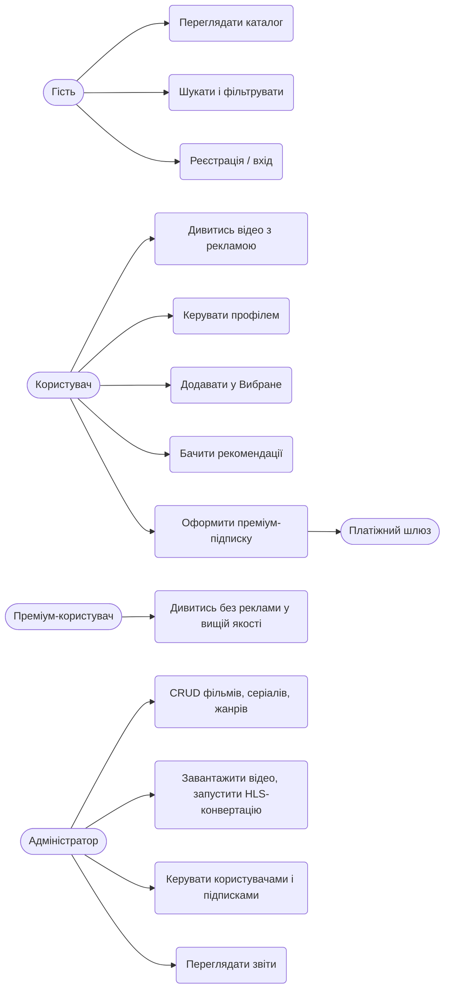
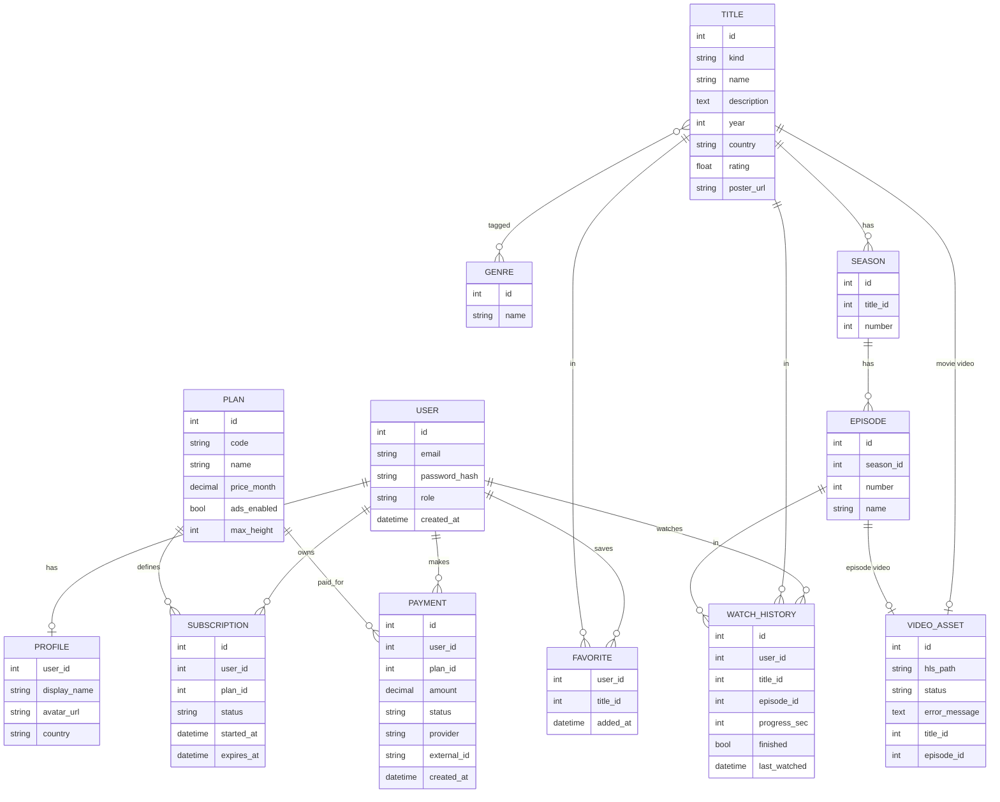
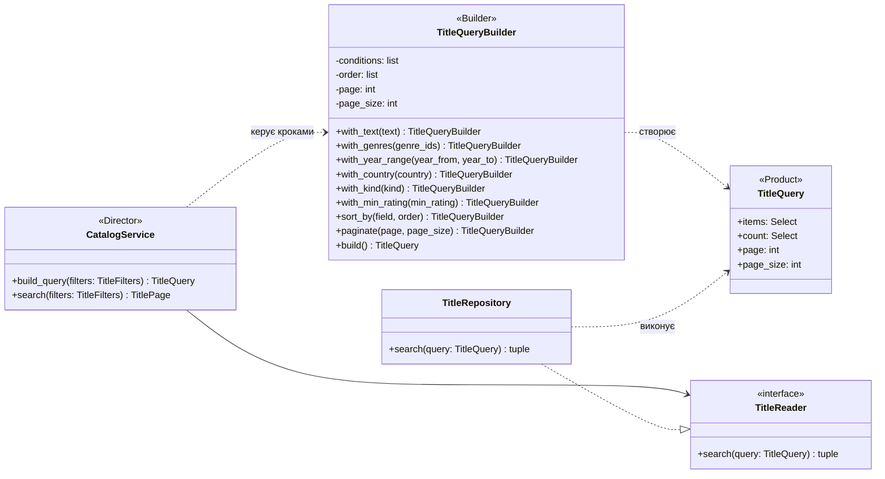
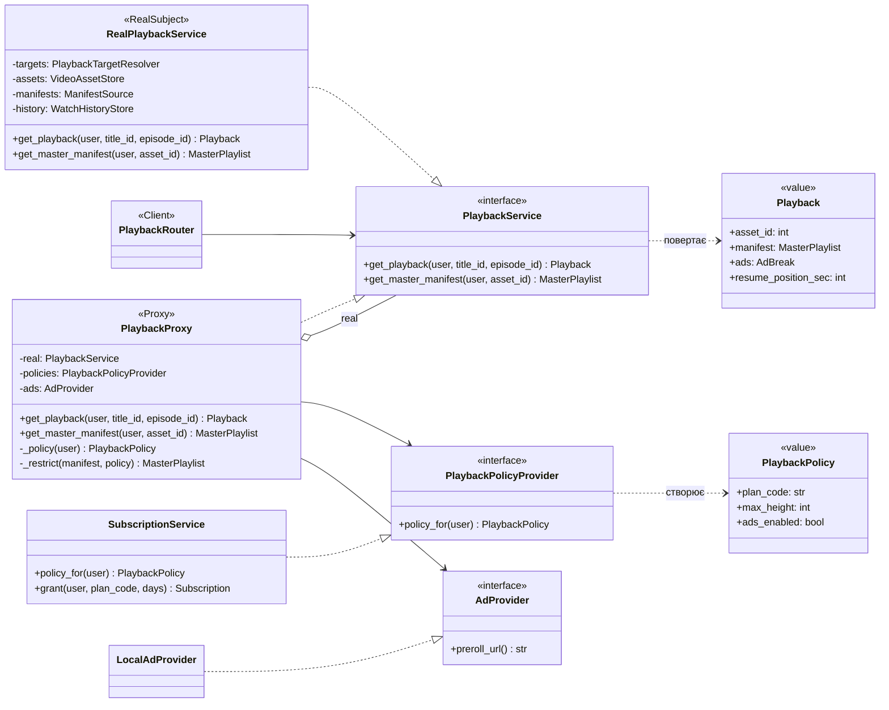
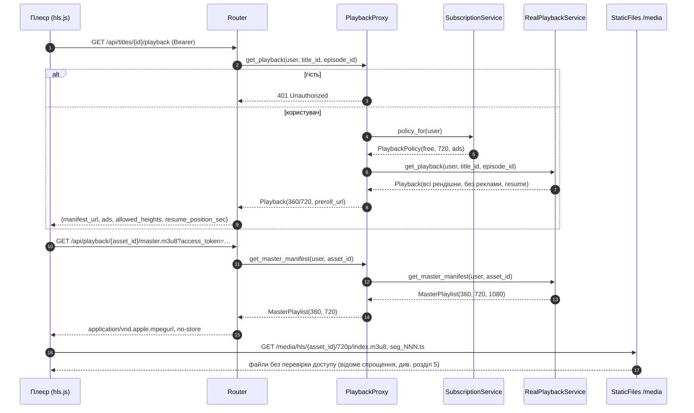

# Архітектура Cinema Platform

## 1. Актори і Use Cases



Примітка: Користувач наслідує можливості Гостя, Преміум-користувач — Користувача.

## 2. Модель даних (ER)



Плани створюються сідом (`python -m app.seed`): `free` (реклама, до 720p, 0 грн) і `premium` (без реклами, до 1080p,
99 грн/міс). Користувач без активної `SUBSCRIPTION` вважається на плані `free`, тому окремий запис підписки для Free
не створюється. Сід також створює адміністратора з `ADMIN_EMAIL` / `ADMIN_PASSWORD`.

`python -m app.seed --demo` додатково завантажує демо-каталог (`app/demo_data.py`): 12 жанрів, 25 фільмів і 6 серіалів
із сезонами та епізодами. Повторний запуск не створює дублікатів: тайтл шукається за (kind, name, year), довідкові
поля відновлюються, а постер, перейменовані епізоди й додані адміністратором сезони зберігаються.

Цілісність каталогу: номер сезону унікальний у межах тайтлу, номер епізоду — у межах сезону (унікальні обмеження в БД
плюс перевірка в `AdminCatalogService` з кодом 409). Сезони додаються лише до серіалів. Видалення тайтлу каскадно
прибирає сезони, епізоди, зв'язки з жанрами, відео, «Вибране», історію переглядів і файл постера. Постери зберігаються
в `media/posters/` через абстракцію `FileStorage` (`LocalMediaStorage`) і роздаються за адресою `/media/...`.

**Вибране та історія переглядів.**
- `FAVORITE` має складений первинний ключ (користувач, тайтл), тому `POST /api/favorites/{title_id}` ідемпотентний
  (`INSERT … ON CONFLICT DO NOTHING`, 204), як і `DELETE` (204 навіть для відсутнього запису).
- `GET /api/favorites` повертає ті самі картки `TitlePage`, що й каталог, від нових до старих.
- Для авторизованого користувача картки в `GET /api/titles` і `GET /api/titles/{id}` мають `is_favorite`; гість
  отримує `false`.
- `WATCH_HISTORY` має один запис на трійку (користувач, тайтл, епізод). Унікальне обмеження
  `NULLS NOT DISTINCT` (PostgreSQL 15+) робить фільм з `episode_id = NULL` теж унікальним.
- `PUT /api/history/progress` виконує upsert (`ON CONFLICT DO UPDATE`) і оновлює `last_watched`. Видалення епізоду
  каскадно видаляє його прогрес.
- `GET /api/history` («Продовжити перегляд») повертає незавершені записи з ненульовим прогресом: для серіалу лише
  останній переглянутий епізод (`DISTINCT ON (title_id)`), від найсвіжіших до старіших.
- `HistoryService.record_progress` визначає перехід «не завершено → завершено» (`just_finished`). Це єдине місце,
  де в Дні 4 публікуватиметься подія `WatchFinished`.
- Популярність у каталозі — кількість різних користувачів, які дивились тайтл (`COUNT(DISTINCT user_id)`), тому
  перегляд кількох епізодів серіалу одним користувачем не завищує рейтинг.

## 3. Патерни і взаємодія

```
Router ──> PlaybackService (інтерфейс) = PlaybackProxy ──> RealPlaybackService ──> VideoAsset, master.m3u8
                                   │  політика плану: SubscriptionService (День 4: Factory Method → PlanPolicy)
                                   └─ повертає: дозволені якості, прапорець реклами, позицію відновлення
Router ──> CatalogService (Director) ──> TitleQueryBuilder ──build()──> TitleQuery ──> TitleRepository
Router ──> RecommendationService ──> RecommendationStrategy (Genre | Popularity | Hybrid)
Router ──> BillingService ──> PaymentGateway (Adapter → MockGateway: success/pending/failed)
                    │ успіх
                    └─> EventBus.publish(PaymentSucceeded) ──> SubscriptionActivator (Observer)
HistoryService.record_progress ──(just_finished)──> EventBus.publish(WatchFinished) ──> StatsUpdater (Observer)
Reports: ReportGenerator (Template Method) ──> PopularTitles | UserActivity | Revenue
```

Як патерни працюють разом: проксі отримує політику від фабрики, платіж через адаптер породжує подію, яку обробляють
спостерігачі (активація підписки), після чого проксі вже пускає користувача без реклами.

GRASP: Controller (роутери), Information Expert (політика плану знає про рекламу і якість), Low Coupling / High Cohesion
(шари), Polymorphism (стратегії, шлюзи), Pure Fabrication (EventBus), Protected Variations (інтерфейс шлюзу).

### 3.1 Builder — пошук і фільтри каталогу

Файл: `backend/app/patterns/title_query_builder.py`. Тести: `backend/tests/test_title_query_builder.py`.

**Проблема.** `GET /api/titles` має десять необов'язкових параметрів: текст, жанри, роки «від» і «до», країна, тип,
мінімальний рейтинг, сортування, напрям, сторінка. Будь-яка їх комбінація допустима. Якщо збирати SQL-запит
умовами `if` у роутері чи репозиторії, виходить довгий метод, у якому змішано HTTP, бізнес-правила і ORM. Сигнатура
`search(q, genres, year_from, year_to, ...)` розростається, а кожен новий фільтр вимагає змін у кількох шарах.

**Рішення.** Запит будується покроково: кожен крок додає одну умову і повертає сам білдер (fluent-інтерфейс), а
`build()` віддає готовий продукт — пару запитів «записи сторінки» і «загальна кількість» з однаковими умовами.



| Роль GoF | Клас | Відповідальність |
|---|---|---|
| Builder | `TitleQueryBuilder` | знає, як кожен фільтр перетворюється на SQL-умову |
| Director | `CatalogService.build_query` | знає, які кроки викликати для `TitleFilters` |
| Product | `TitleQuery` | незмінний результат: запит сторінки, count-запит, межі сторінки |
| Client | `TitleRepository.search` | виконує продукт, не знаючи, як його зібрано |

**Використання в `CatalogService`.**

```python
query = (
    TitleQueryBuilder()
    .with_text(filters.q)
    .with_genres(filters.genre)
    .with_year_range(filters.year_from, filters.year_to)
    .with_country(filters.country)
    .with_kind(filters.kind)
    .with_min_rating(filters.min_rating)
    .sort_by(filters.sort, filters.order)
    .paginate(filters.page, filters.page_size)
    .build()
)
items, total = self.titles.search(query)
```

Потік: роутер валідує параметри в `TitleFilters` (Pydantic, 422) → `CatalogService` як директор збирає `TitleQuery` →
репозиторій через абстракцію `TitleReader` виконує обидва запити → сервіс повертає `TitlePage {items, total, page, page_size}`.

Ключові рішення всередині білдера:
- незаданий параметр (`None`, порожній рядок, порожній список) не додає умови, тому директор викликає всі кроки без `if`;
- жанри з'єднуються логікою «будь-який із» через підзапит `title_id IN (...)`, тому немає дублікатів рядків, а `total`
  рахується правильно без `DISTINCT`;
- текст шукається через `ILIKE` у назві й описі, символи `%` і `_` екрануються;
- сортування стабільне: до будь-якого поля додається `id`, щоб сторінки не перекривались; для кожного поля є
  природний напрям за замовчуванням (рейтинг, рік, популярність — за спаданням, назва — за зростанням);
- білдер сам перевіряє інваріанти продукту (`page_size ≤ 50`, `year_from ≤ year_to`, рейтинг 0–10) і кидає 422, тож
  некоректний запит неможливо зібрати незалежно від того, хто викликає білдер.

**Чому патерн доречний.**
- Об'єкт (запит) складний, має багато необов'язкових частин і будується покроково — це класичний випадок Builder.
- SRP: SQL-логіка фільтрів зосереджена в одному класі; роутер працює лише з HTTP, сервіс — лише з порядком кроків,
  репозиторій — лише з виконанням.
- OCP: новий фільтр — це новий метод білдера і один рядок у директорі; репозиторій і роутер-контракт не змінюються.
- DIP: `CatalogService` залежить від протоколу `TitleReader`, а не від SQLAlchemy-репозиторію.
- Тестованість: кожен крок і їхні комбінації перевіряються окремо (44 unit-тести), без HTTP-шару.
- Повторне використання: той самий білдер знадобиться для рекомендацій (вибірка кандидатів за жанрами й рейтингом)
  та адмін-списків.

Відмінність від канонічної схеми GoF: абстрактного інтерфейсу Builder немає, бо існує одне подання продукту
(SQLAlchemy `Select`). Якщо з'явиться інше джерело пошуку (наприклад, повнотекстовий індекс), достатньо виділити
інтерфейс із тими самими кроками — директор `CatalogService` при цьому не зміниться.

### 3.2 Proxy — доступ до відтворення

Файл: `backend/app/patterns/playback_proxy.py`. Тести: `backend/tests/test_playback_proxy.py` (6 unit-тестів проксі
на фейках і 22 API-сценарії на реальних файлах маніфестів), `backend/tests/test_subscriptions.py`.

**Проблема.** Видача відео поєднує дві різні відповідальності. Перша — знайти, що відтворювати: тайтл або епізод,
готовий `VideoAsset`, його `master.m3u8` і позицію, з якої продовжити. Друга — вирішити, що з цього можна показати
саме цьому користувачеві: чи він увійшов, який у нього план, яка максимальна якість, чи потрібна реклама. Якщо змішати
їх у роутері чи одному сервісі, кожне нове правило (регіональні обмеження, ліміт одночасних переглядів, пробний період)
змінює код, який читає файли й працює з БД. До того ж ту саму перевірку треба продублювати для двох маршрутів: опису
відтворення і самого маніфесту.

**Рішення.** Захисний замісник (protection proxy). `PlaybackProxy` реалізує той самий інтерфейс `PlaybackService`,
що й реальний сервіс, і тримає посилання на нього. Клієнт (роутер) не знає, з ким працює. Проксі спершу перевіряє
доступ, потім делегує реальному сервісу й обмежує результат політикою плану.



| Роль GoF | Клас | Відповідальність |
|---|---|---|
| Subject | `PlaybackService` (ABC) | спільний контракт: опис відтворення і master-плейлист |
| RealSubject | `RealPlaybackService` | знаходить тайтл/епізод і готовий `VideoAsset`, читає `master.m3u8`, переписує URI варіантів на `/media/hls/<id>/...`, рахує `resume_position_sec`; без обмежень і без реклами |
| Proxy | `PlaybackProxy` | 401 для гостя ще до звернення до реального сервісу; отримує `PlaybackPolicy`; лишає лише рендішни з `height ≤ max_height`; вмикає рекламу, якщо план її передбачає і ролик існує |
| Client | роутер `api/routes/playback.py` | отримує `PlaybackService` через DI (`get_playback_service`), не знаючи про проксі |

**Потік запиту.**



**Використання.** Збирання графа об'єктів — єдине місце, яке знає про проксі (`api/deps.py`):

```python
def get_playback_service(session: SessionDep) -> PlaybackService:
    media_root = Path(settings.media_dir)
    real = RealPlaybackService(
        PlaybackTargetResolver(TitleRepository(session), EpisodeRepository(session)),
        VideoAssetRepository(session),
        LocalManifestSource(media_root),
        WatchHistoryRepository(session),
    )
    return PlaybackProxy(real, get_subscription_service(session), LocalAdProvider(media_root))
```

Ядро проксі:

```python
def get_playback(self, user: User | None, title_id: int, episode_id: int | None) -> Playback:
    policy = self._policy(user)
    playback = self.real.get_playback(user, title_id, episode_id)
    preroll = self.ads.preroll_url() if policy.ads_enabled else None
    return replace(
        playback,
        manifest=self._restrict(playback.manifest, policy),
        ads=AdBreak(enabled=preroll is not None, preroll_url=preroll),
    )
```

**Чому Proxy, а не `if` у контролері.**
- SRP: реальний сервіс відповідає за пошук і читання відео, проксі — за права доступу, роутер — лише за HTTP. Кожен
  клас можна змінити, не чіпаючи інші.
- Одне правило для двох маршрутів. Опис відтворення і маніфест проходять через той самий `_policy` / `_restrict`,
  тож неможливо обмежити якість в одному маршруті й забути в іншому. `if` у контролері довелося б дублювати.
- OCP: нові обмеження (регіон, кількість пристроїв, батьківський контроль) додаються в проксі або ще одним проксі в
  ланцюжку з тим самим інтерфейсом. `RealPlaybackService` і роутер не змінюються.
- DIP: проксі залежить від абстракцій `PlaybackPolicyProvider` і `AdProvider`, а не від БД чи файлової системи.
  У Дні 4 `SubscriptionService` віддаватиме політику, створену Factory Method (`PlanPolicy` для Free/Premium), і
  проксі при цьому не зміниться.
- Захист до виконання роботи: гість відсікається ще до звернення до БД і файлів, що перевіряє окремий тест
  (`real.calls == 0`).
- Тестованість: правила плану перевіряються unit-тестами на фейковому реальному сервісі без HTTP і без БД, а реальний
  сервіс — окремо на справжніх файлах.
- Повторне використання: `RealPlaybackService` можна викликати напряму там, де обмеження не потрібні (наприклад,
  для адмінського перегляду), без прапорців на кшталт `skip_checks=True`.

GRASP: Protected Variations (правила доступу сховані за інтерфейсом `PlaybackService`), Indirection (проксі між
клієнтом і реальним сервісом), Information Expert (`PlaybackPolicy` знає про якість і рекламу), Pure Fabrication
(`PlaybackTargetResolver` — спільна перевірка «тайтл/епізод» для відтворення та історії).

**Відомі спрощення.**
- Проксі контролює лише master-плейлист. Варіантні плейлисти й сегменти віддаються статично, тож прямий URL
  `1080p/index.m3u8` доступний без перевірки. Варіанти покращення (підписані URL з терміном дії, nginx `secure_link`,
  AES-128) описані в розділі 5.
- Фонове транскодування живе в процесі застосунку (`BackgroundTasks`). Якщо процес перезапуститься посеред роботи,
  при старті такі записи переводяться у `failed` з повідомленням `interrupted by restart`, і відео треба завантажити
  повторно. Повноцінне рішення — черга задач (наприклад, Celery або RQ) з повторними спробами.

## 4. Оплата (mock)

1. `POST /billing/checkout {plan_code}` → створює `Payment(status=created)`, повертає `payment_id`.
2. UI показує сторінку оплати з вибором результату: **success / pending / failed**.
3. `POST /billing/payments/{id}/mock-result {outcome}` → MockGateway повертає результат:
   - success → `Payment=success`, подія `PaymentSucceeded`, підписка Premium активна на 30 днів;
   - pending → `Payment=pending`, підписка не змінюється; адмін або користувач може пізніше «підтвердити» (повторний виклик);
   - failed → `Payment=failed`, підписка не змінюється.

## 5. HLS

**Конвертація.** `HlsTranscoder` (`services/hls_transcoder.py`) запускає `ffmpeg` через `subprocess` без shell
(шлях — `FFMPEG_PATH`). Спершу `probe` читає роздільність, частоту кадрів і наявність аудіо, потім для кожного рендішну
360p / 720p / 1080p, не вищого за джерело, окремий виклик кодує H.264 High + AAC (`-preset veryfast`, сегменти по 6 с,
ключові кадри на межах сегментів). `master.m3u8` пише сам застосунок через `MasterPlaylist`: `BANDWIDTH` — виміряний пік
бітрейту сегментів, `CODECS` відповідає явно заданим профілю й рівню (`avc1.64001f` для ≤720p, `avc1.640028` для 1080p,
`mp4a.40.2` лише якщо в джерелі є звук). Результат спершу пишеться в тимчасову теку й лише після успіху замінює
попередній, тож повторне завантаження не лишає напівзаписаних файлів.

```
media/
├── uploads/<asset_id>/source.<mp4|mkv|mov>   джерело до завершення конвертації
├── hls/<asset_id>/master.m3u8
│   └── {360p,720p,1080p}/index.m3u8 + seg_NNN.ts
└── ads/preroll/master.m3u8 + 720p/           реклама перед відео (один рендішн)
```

**Статуси `VideoAsset`:** `pending` (джерело прийнято) → `processing` → `ready` (`hls_path` заповнено) або `failed`
(`error_message` — хвіст stderr ffmpeg). Одне відео на фільм або епізод (unique + check «рівно один власник»).
При старті застосунку записи, що лишились у `processing` після перезапуску, переводяться у `failed` з повідомленням
`interrupted by restart`.

**Завантаження адміністратором.** `POST /api/admin/titles/{id}/video` (лише фільми) і `POST /api/admin/episodes/{id}/video`
приймають multipart-файл mp4/mkv/mov (перевіряються розширення й сигнатура контейнера, ліміт `MAX_VIDEO_UPLOAD_MB`),
повертають `202` зі статусом `pending` і ставлять `VideoProcessingService.process` у `BackgroundTasks`. Фонова задача
працює з власною сесією БД, а ffmpeg виконується поза транзакцією. Стан видно в `GET /api/admin/video-assets/{id}`.

**Демо без інтернету.** `python -m app.tools.demo_media [--titles 5] [--episodes 3] [--duration 40] [--force]` генерує
через `lavfi` (testsrc2 + синус) кліпи 1080p з назвою тайтлу і пропускає їх тим самим шляхом, що й адмінське
завантаження (`VideoUploadService` → `VideoProcessingService`). Окремо створюється 8-секундна реклама «Реклама».

**Відтворення.** Бекенд віддає `master.m3u8` через Playback Proxy: Free бачить до 720p і рекламу перед відео,
Premium — до 1080p без реклами. План визначає `SubscriptionService`: активна непрострочена підписка дає її план,
інакше діє `free`.

| Запит | Відповідь |
|---|---|
| `GET /api/titles/{id}/playback?episode_id=` (Bearer) | `{manifest_url, ads: {enabled, preroll_url}, allowed_heights, resume_position_sec}` |
| `GET /api/playback/{asset_id}/master.m3u8` (Bearer або `?access_token=`) | відфільтрований master-плейлист, `Cache-Control: no-store` |

Гість отримує 401, тайтл без готового відео — 404 `video_not_ready` з поясненням (не завантажено / ще обробляється /
обробка не вдалась). Для серіалу `episode_id` обов'язковий (422 `episode_required`). `ads.enabled` істинне лише тоді,
коли план передбачає рекламу і ролик `media/ads/preroll` справді існує. `resume_position_sec` береться з незавершеного
запису історії, для завершеного перегляду — 0. Токен у query дозволено лише для маршруту маніфесту, бо hls.js
завантажує його сам і не завжди може передати заголовок.

Ручна перевірка преміуму без оплати: `python -m app.tools.grant_premium <email> [--days 30]` — створює або продовжує
активну Premium-підписку.

**Відоме спрощення: сегменти віддаються статично.** Проксі контролює лише master-плейлист. Варіантні плейлисти
(`/media/hls/<id>/1080p/index.m3u8`) і сегменти `.ts` роздає `StaticFiles` без перевірки, тож користувач Free, який
знає структуру каталогів, може напряму відкрити 1080p, а гість — будь-який сегмент. Для курсового проєкту це прийнятно,
бо бізнес-правила (якість, реклама) застосовуються на рівні, з яким працює плеєр. Варіанти покращення:
1. **Підписані URL:** проксі переписує URI варіантів на `/media/hls/<id>/720p/index.m3u8?exp=…&sig=…`, де `sig` —
   HMAC-SHA256 від `asset_id/шлях/exp` на `SECRET_KEY`. Варіантні плейлисти теж віддаються через API з підписаними
   URI сегментів, а статична роздача перевіряє підпис і термін дії.
2. **Делегування вебсерверу:** nginx `secure_link` або `X-Accel-Redirect`: бекенд лише перевіряє право доступу,
   а файл віддає nginx.
3. **Шифрування сегментів:** AES-128 (`#EXT-X-KEY`), де ключ видається через API лише авторизованим користувачам.

## 6. План на 7 днів

| День | Дата | Результат |
|---|---|---|
| 1 | сб 21.11 | Репозиторій, compose, моделі, Alembic, auth (реєстрація/вхід/JWT), каркас React |
| 2 | нд 22.11 | Каталог, пошук/фільтри (Builder), адмін CRUD для фільмів/жанрів |
| 3 | пн 23.11 | ffmpeg → HLS, плеєр, Playback Proxy, Вибране, історія переглядів |
| 4 | вт 24.11 | Плани, Factory Method, оплата (Adapter + mock UI), EventBus (Observer) |
| 5 | ср 25.11 | Рекомендації (Strategy), звіти (Template Method), адмін-дашборд |
| 6 | чт 26.11 | Тести, полірування UI, UML (Use Case, класи з кольорами патернів), скріни |
| 7 | пт 27.11 | Звіт, README, фінальний прогін розгортання з нуля, запас часу |
