# UML-діаграми Cinema Platform

Вихідні файли — PlantUML (`*.puml`), спільний стиль і кольори патернів — у `_style.iuml`.
Поруч лежать відрендерені PNG (150 dpi, для друку) і SVG (для перегляду з масштабуванням).
Шрифт — DejaVu Sans (є в образі `plantuml/plantuml`, підтримує кирилицю).

## Рендер

З кореня репозиторію в PowerShell:

```powershell
docker run --rm -e PLANTUML_LIMIT_SIZE=8192 -v "${PWD}/docs/uml:/data" plantuml/plantuml -tpng "/data/*.puml"
docker run --rm -e PLANTUML_LIMIT_SIZE=8192 -v "${PWD}/docs/uml:/data" plantuml/plantuml -tsvg "/data/*.puml"
```

Команд дві, бо PlantUML 1.2026 приймає лише один формат за запуск: якщо передати `-tpng -tsvg` разом,
згенерується тільки PNG. `PLANTUML_LIMIT_SIZE=8192` піднімає стандартну межу 4096 px: без неї оглядова діаграма
класів (5382 px завширшки) обрізається. Файл `_style.iuml` маска `*.puml` не зачіпає, він підключається через
`!include`.

## Діаграми

### Use Case — `use_cases.png`


П'ять акторів: Гість, Користувач (Free), Преміум-користувач, Адміністратор і зовнішня система «Платіжний шлюз».
Узагальнення акторів: Користувач успадковує всі прецеденти Гостя, Преміум-користувач і Адміністратор — прецеденти
Користувача (адміністратор у коді — той самий `User` з роллю `admin`). Прецеденти згруповані в пакети Каталог,
Перегляд, Профіль і Вибране, Підписка та оплата, Адміністрування, Звіти.

Що головне:
- «Дивитись відео» завжди `<<include>>` перевірку входу і плану та обмеження якості — це робить `PlaybackProxy`
  (гість без входу отримує 401). Показ реклами `<<extend>>` перегляд лише для плану Free, перемикання якості —
  за бажанням глядача; «Дивитись без реклами до 1080p» — спеціалізація перегляду для Premium.
- Оформлення Premium і вибір результату mock-оплати `<<include>>` взаємодію з платіжним шлюзом
  (`MockGatewayAdapter` → `MockPaymentProvider`). Активація Premium і сповіщення `<<extend>>` вибір результату
  лише за умови `success`; так само після підтвердження адміністратором pending-платежу.
- Рекомендації доступні й гостю: без історії переглядів сервіс повертає популярне, для користувача — персональні
  (жанри, схожі тайтли, гібрид).
- Завантаження відео адміністратором `<<include>>` конвертацію у HLS (ffmpeg, 360p/720p/1080p) у фоновій задачі.
- Три звіти — спеціалізації «Сформувати звіт», експорт у CSV його `<<extend>>`.

### Оглядова діаграма класів з патернами — `classes_overview.png`


Головна діаграма для розділу про патерни: усі сім GoF-патернів і сервіси, що ними користуються (50 класів).
Кожен пакет — один патерн із файлом, де він живе; фон класу — колір патерну з легенди, стереотип — роль у патерні
(`<<Creator>>`, `<<Proxy>>`, `<<Adaptee>>`, `<<Context>>` тощо). Білі класи — сервіси-клієнти й допоміжні протоколи.
Читати варто від білого пакета «Сервіси» в центрі: від нього стрілки ведуть до кожного патерну. Так видно, що
`SubscriptionService` водночас бере політики з Factory Method, віддає їх у Proxy через `PlaybackPolicyProvider`
і публікує події в Observer, а `BillingService` об'єднує Factory Method, Adapter і Observer.

Повна діаграма всіх шарів на одному аркуші (60+ класів) виходила нечитабельною, тому шари показано окремо нижче.

### Шар API — `classes_layer_api.png`

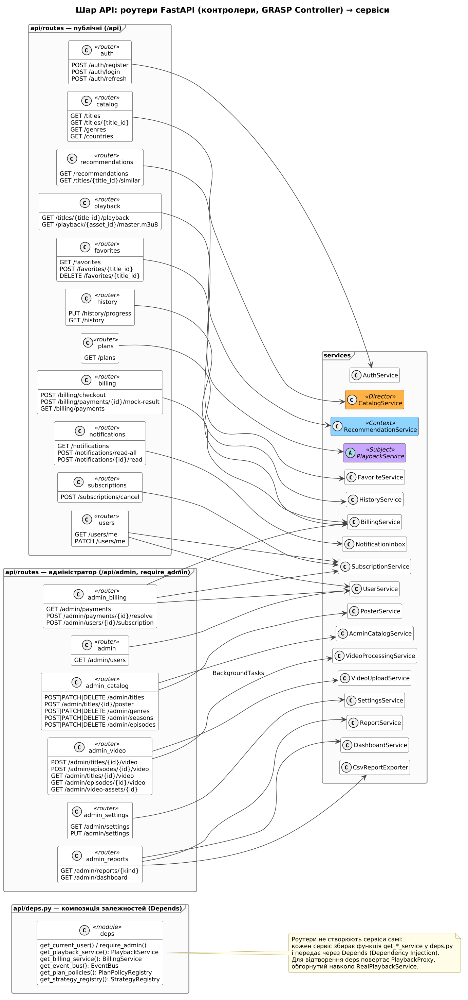

Роутери FastAPI в ролі контролерів (GRASP Controller) з переліком ендпоінтів і сервіси, яким вони делегують
роботу. Роутер не містить бізнес-логіки й не створює сервіс сам: усі залежності збирає `api/deps.py` через
`Depends`. Для відтворення туди підставляється `PlaybackProxy`, а не `RealPlaybackService`. Публічні роутери
відокремлено від адмінських, які закриває `require_admin`.

### Шари сервісів і даних — `classes_layer_data.png`


Як виконано DIP. Атрибути сервісу — це параметри його конструктора: протоколи з `services/ports.py`
(`TitleReader`, `PaymentStore`, `VideoAssetStore` тощо), а не конкретні класи. Рядок «реалізує» в репозиторії чи
інфраструктурному класі показує, які протоколи він задовольняє структурно (`typing.Protocol`). Тому зв'язок
«сервіс → репозиторій» знаходиться за назвою протоколу, без десятків перехресних стрілок. Стереотип
`<<SqlAlchemyRepository[T]>>` означає успадкування від узагальненого базового репозиторію з CRUD.

### Доменна модель — `classes_domain.png`

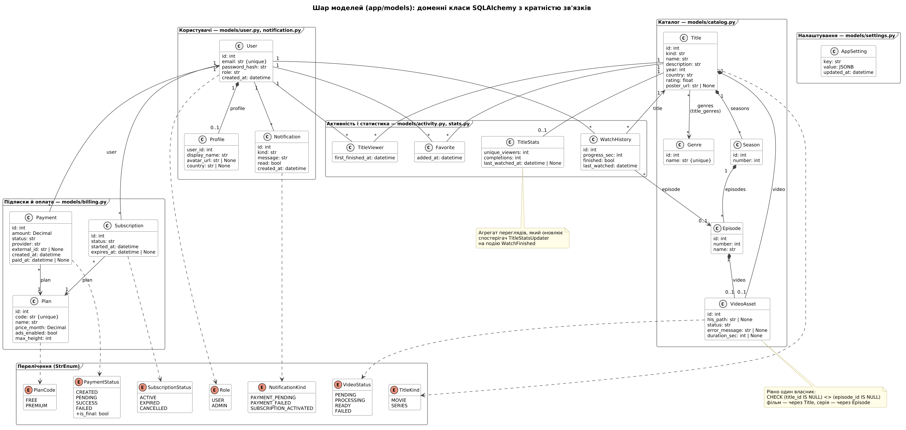

Моделі SQLAlchemy з `app/models` з атрибутами, кратністю і навігацією зв'язків. Композиція (зафарбований ромб)
стоїть там, де ORM каскадно видаляє залежні об'єкти: профіль користувача, сезони й епізоди тайтла, відеофайл.
`Favorite`, `WatchHistory` і `TitleViewer` — асоціативні класи між `User` і `Title`. Перелічення (`StrEnum`)
задають допустимі значення рядкових полів `role`, `code` і `status`. Фізичну схему з ключами й обмеженнями показує
ER-діаграма.

## Діаграми окремих патернів

На кожній — класи одного патерну з ключовими методами, роль GoF у стереотипі, той самий колір, що й на
оглядовій, і примітка «Яку проблему вирішує». Білі класи — клієнти патерну та допоміжні типи. Ці діаграми
розраховані на друк на A4 (альбомна орієнтація).

### Builder — `pattern_builder.png`


`CatalogService.build_query()` (Director) викликає ланцюжок `with_*()` у `TitleQueryBuilder` і отримує незмінний
продукт `TitleQuery` — пару SQL-запитів «сторінка» і «загальна кількість». Кожен крок додає умову лише для
заданого фільтра й перевіряє свій параметр.

### Factory Method — `pattern_factory_method.png`

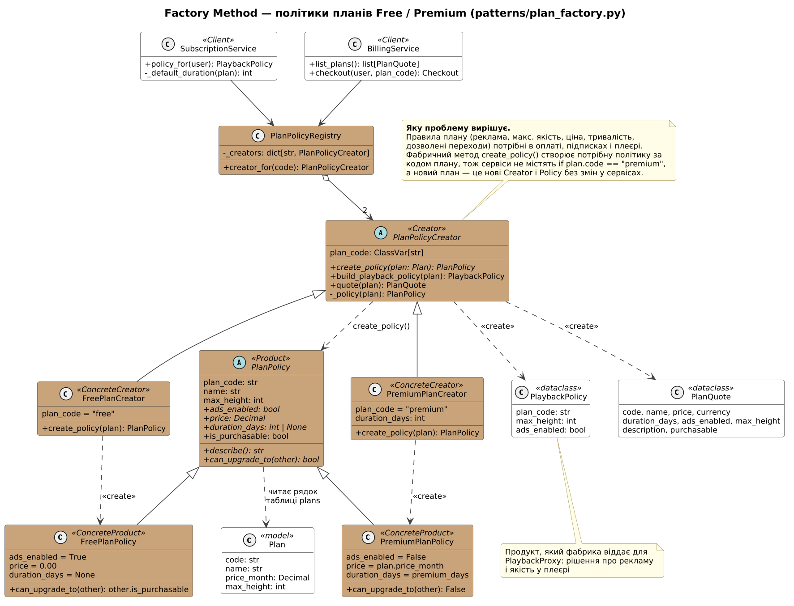

Абстрактний `PlanPolicyCreator` оголошує фабричний метод `create_policy()`, `FreePlanCreator` і
`PremiumPlanCreator` створюють відповідні `PlanPolicy`. На спільному інтерфейсі продукту базові методи творця
`quote()` і `build_playback_policy()` будують ціну для сторінки планів і `PlaybackPolicy` для плеєра.
`PlanPolicyRegistry` видає творця за кодом плану.

### Proxy — `pattern_proxy.png`


`PlaybackProxy` і `RealPlaybackService` реалізують один `PlaybackService`, тому роутер не помічає підміни.
Проксі перевіряє вхід, бере політику плану через `PlaybackPolicyProvider` (його реалізує `SubscriptionService`),
делегує реальному сервісу й обрізає `MasterPlaylist` до `max_height`, а для Free додає pre-roll від `AdProvider`.

### Adapter — `pattern_adapter.png`

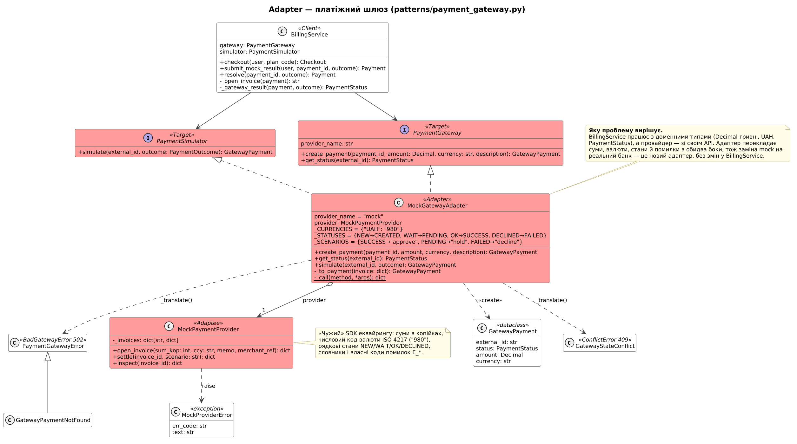

`BillingService` знає лише цільові інтерфейси `PaymentGateway` і `PaymentSimulator`. `MockGatewayAdapter`
реалізує обидва поверх `MockPaymentProvider` з несумісним API: перекладає гривні в копійки, `UAH` у `"980"`,
стани `NEW/WAIT/OK/DECLINED` у `PaymentStatus`, а помилки `E_*` — у винятки застосунку з HTTP-кодами 502 і 409.

### Observer — `pattern_observer.png`

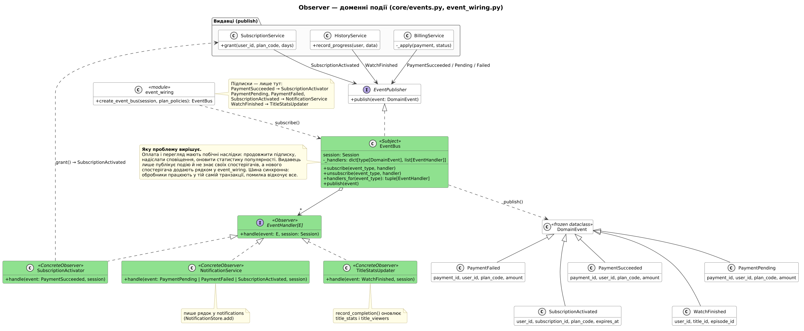

Сервіси-видавці залежать лише від `EventPublisher`. `EventBus` (Subject) зберігає обробників за типом події,
а підписки зібрано в одному місці — `event_wiring.create_event_bus()`. Ланцюжок
`PaymentSucceeded → SubscriptionActivator → grant() → SubscriptionActivated → NotificationService` показує, що
спостерігач сам може стати видавцем.

### Strategy — `pattern_strategy.png`

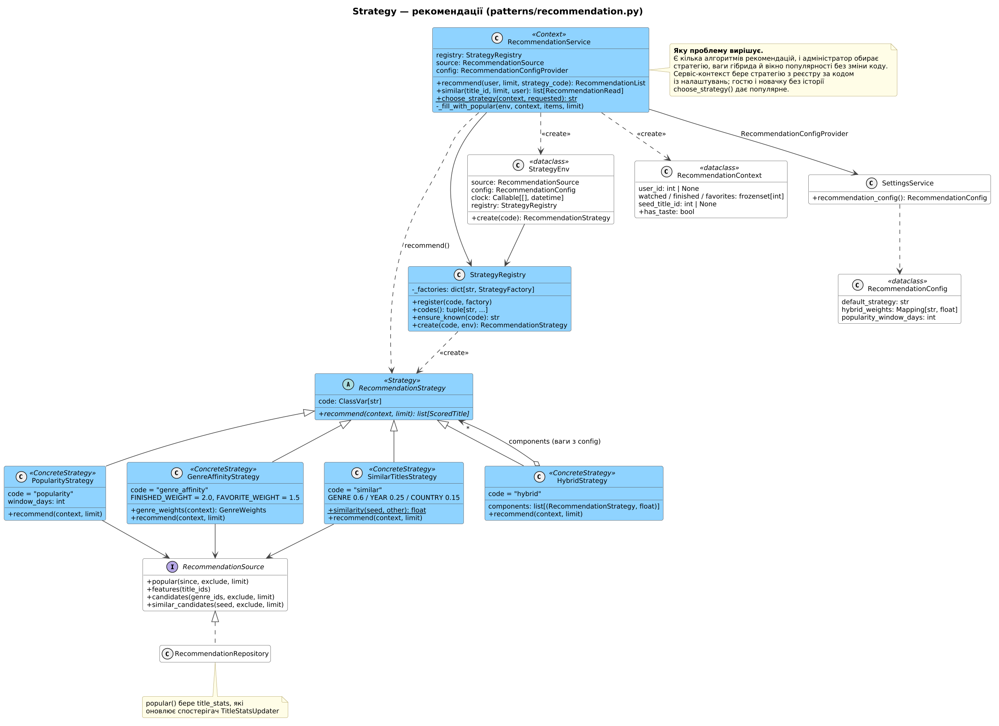

`RecommendationService` (Context) бере стратегію з `StrategyRegistry` за кодом із налаштувань адміністратора.
Чотири конкретні стратегії мають спільний метод `recommend(context, limit)`. `HybridStrategy` одночасно є
стратегією і композицією інших стратегій із вагами з `RecommendationConfig`. Дані стратегії беруть лише через
протокол `RecommendationSource`.

### Template Method — `pattern_template_method.png`

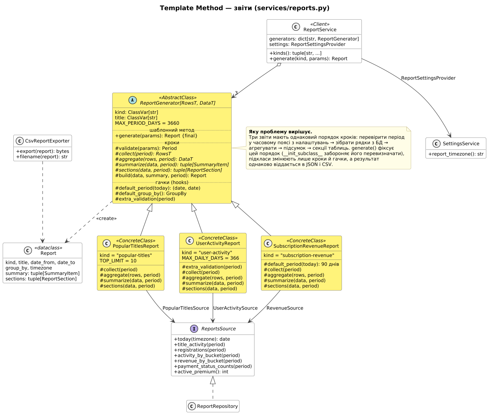

`ReportGenerator.generate()` позначений `{final}` і задає порядок кроків: `validate → collect → aggregate →
summarize → build`. Кожен звіт реалізує абстрактні кроки, а через гачки змінює поведінку за замовчуванням:
`UserActivityReport` обмежує денне групування (`extra_validation`), `SubscriptionRevenueReport` бере 90 днів
замість 30 (`default_period`).

## Інші діаграми

### ER-діаграма (фізична модель БД) — `er.png`

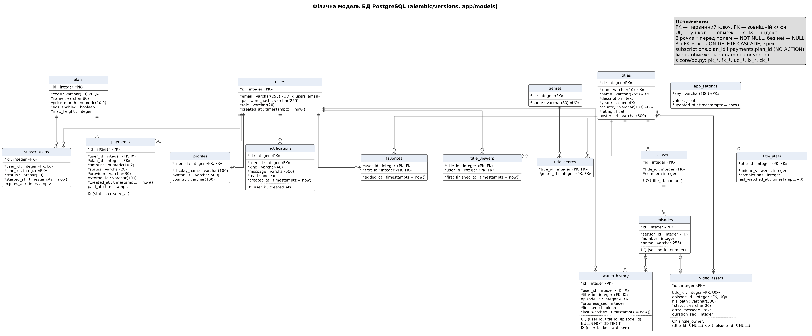

Сімнадцять таблиць PostgreSQL зі стовпцями, типами, `NOT NULL` (зірочка), первинними й зовнішніми ключами,
унікальними обмеженнями та індексами. Діаграма зведена з моделей SQLAlchemy і перевірена за міграціями Alembic.
Варто звернути увагу на складені ключі (`favorites`, `title_genres`, `title_viewers`), на CHECK
`single_owner` у `video_assets` (відео належить або фільму, або епізоду) і на унікальність прогресу
`watch_history` з `NULLS NOT DISTINCT` (один запис на фільм, де `episode_id IS NULL`). Усі FK видаляються
каскадно, крім посилань на `plans`.

### Послідовність: оплата — `seq_payment.png`

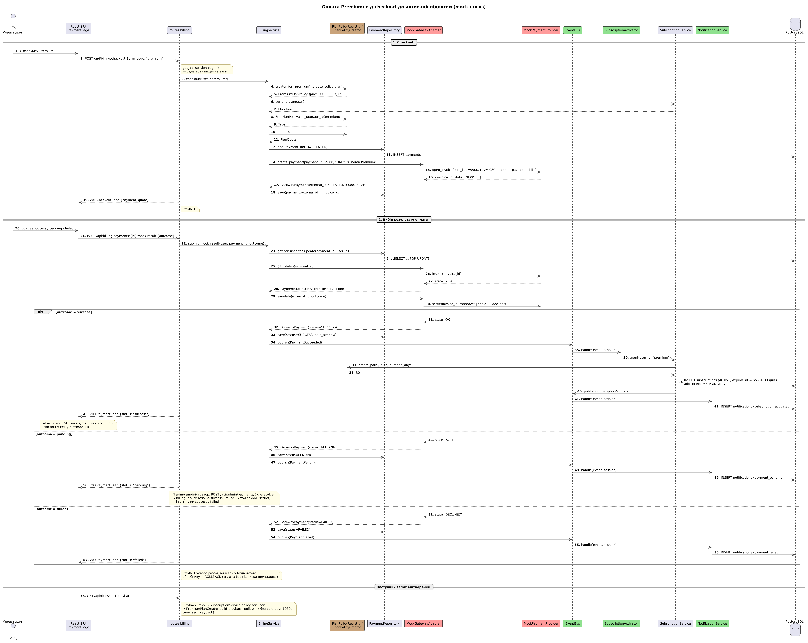

Два HTTP-запити: checkout створює платіж і рахунок у провайдері, а вибір результату на сторінці оплати
проводить його. Гілки `alt` показують success, pending і failed. Кольори учасників збігаються з кольорами
патернів, тож видно ланцюжок Factory Method (ціна, дозвіл на перехід, тривалість) → Adapter (копійки, `"980"`,
стани провайдера) → Observer (`PaymentSucceeded` → `SubscriptionActivator` → `SubscriptionService.grant` →
`SubscriptionActivated` → `NotificationService`). Усе відбувається в одній транзакції запиту: якщо обробник
падає, відкочуються і платіж, і підписка.

### Послідовність: перегляд — `seq_playback.png`

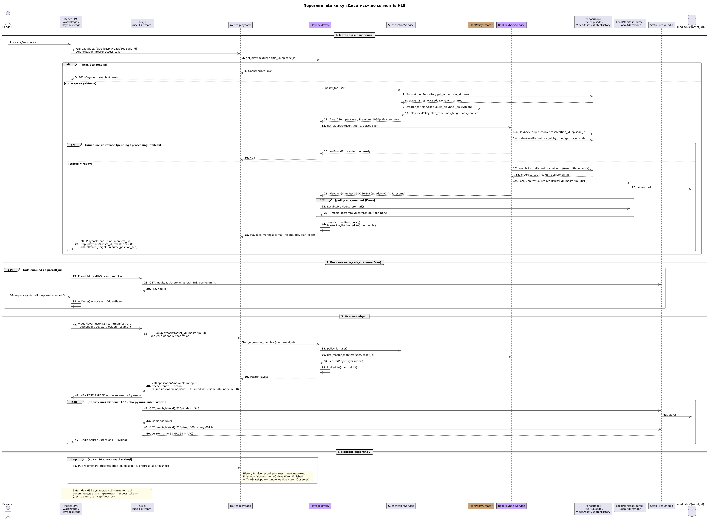

Від кліку «Дивитись» до сегментів HLS. Спочатку `GET /titles/{id}/playback` проходить через `PlaybackProxy`:
перевіряється вхід, будується політика плану (Factory Method), реальний сервіс шукає готове відео й позицію
відновлення, проксі обрізає якості й для Free додає pre-roll. Далі hls.js із JWT запитує `master.m3u8` знову
через проксі, а медіаплейлисти й `.ts`-сегменти бере як статику `/media`. Наприкінці плеєр кожні 10 с
надсилає прогрес, а завершений перегляд запускає Observer → статистику для рекомендацій.

### Компоненти і розгортання — `components.png`

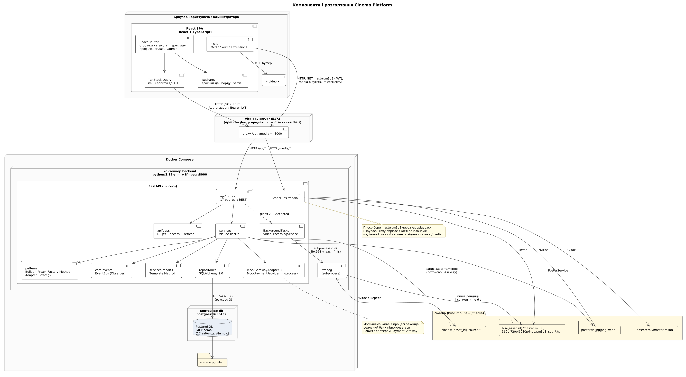

Браузер із React SPA (React Router, TanStack Query, hls.js, Recharts) звертається до Vite dev server, який
проксіює `/api` і `/media` на FastAPI. У Docker Compose працюють контейнер `backend` (uvicorn і ffmpeg, бо
транскодування запускається як `subprocess` з фонової задачі) і контейнер `db` з PostgreSQL 16 на томі
`pgdata`. Тека `./media` змонтована в бекенд: туди пишуться завантаження, HLS-рендиції та постери, а
`StaticFiles` їх роздає. Підписи на зв'язках — протоколи: JSON REST з Bearer JWT, HLS поверх HTTP, SQL
по TCP 5432, файловий ввід-вивід.
