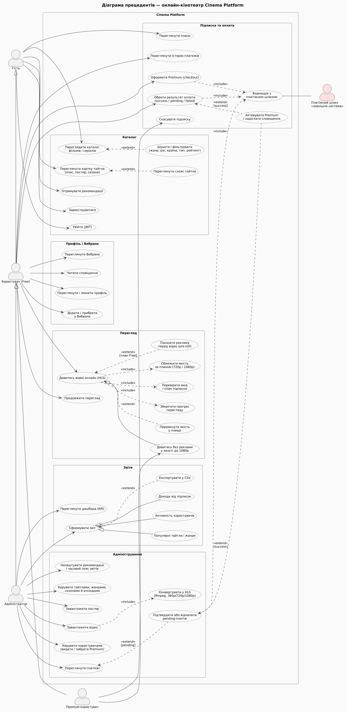
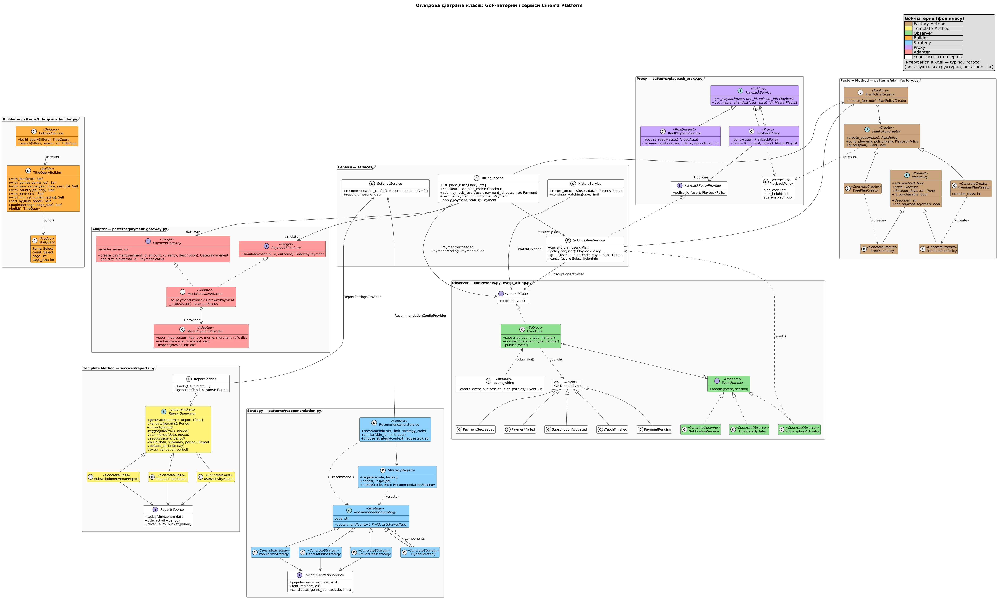
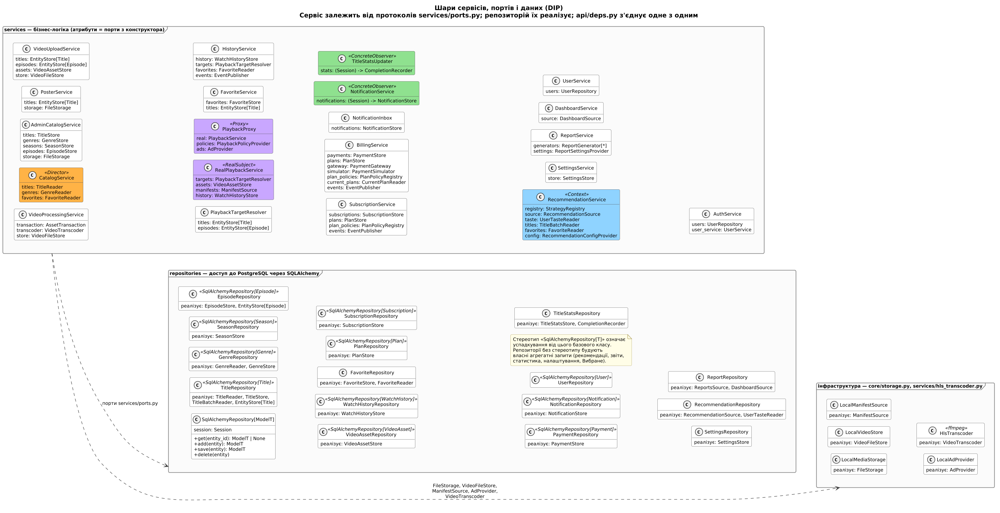

# UML-діаграми Cinema Platform

Вихідні файли — PlantUML (`*.puml`), спільний стиль і кольори патернів — у `_style.iuml`.
Поруч лежать відрендерені PNG (150 dpi, для друку) і SVG (для перегляду з масштабуванням).
Шрифт — DejaVu Sans (є в образі `plantuml/plantuml`, підтримує кирилицю).

## Рендер

З кореня репозиторію в PowerShell:

```powershell
docker run --rm -e PLANTUML_LIMIT_SIZE=8192 -v "${PWD}/docs/uml:/data" plantuml/plantuml -tpng "/data/*.puml"
docker run --rm -e PLANTUML_LIMIT_SIZE=8192 -v "${PWD}/docs/uml:/data" plantuml/plantuml -tsvg "/data/*.puml"
```

Команд дві, бо PlantUML 1.2026 приймає лише один формат за запуск: якщо передати `-tpng -tsvg` разом,
згенерується тільки PNG. `PLANTUML_LIMIT_SIZE=8192` піднімає стандартну межу 4096 px: без неї оглядова діаграма
класів (5382 px завширшки) обрізається. Файл `_style.iuml` маска `*.puml` не зачіпає, він підключається через
`!include`.

## Діаграми

### Use Case — `use_cases.png`



П'ять акторів: Гість, Користувач (Free), Преміум-користувач, Адміністратор і зовнішня система «Платіжний шлюз».
Узагальнення акторів: Користувач успадковує всі прецеденти Гостя, Преміум-користувач і Адміністратор — прецеденти
Користувача (адміністратор у коді — той самий `User` з роллю `admin`). Прецеденти згруповані в пакети Каталог,
Перегляд, Профіль і Вибране, Підписка та оплата, Адміністрування, Звіти.

Що головне:
- «Дивитись відео» завжди `<<include>>` перевірку входу і плану та обмеження якості — це робить `PlaybackProxy`
  (гість без входу отримує 401). Показ реклами `<<extend>>` перегляд лише для плану Free, перемикання якості —
  за бажанням глядача; «Дивитись без реклами до 1080p» — спеціалізація перегляду для Premium.
- Оформлення Premium і вибір результату mock-оплати `<<include>>` взаємодію з платіжним шлюзом
  (`MockGatewayAdapter` → `MockPaymentProvider`). Активація Premium і сповіщення `<<extend>>` вибір результату
  лише за умови `success`; так само після підтвердження адміністратором pending-платежу.
- Рекомендації доступні й гостю: без історії переглядів сервіс повертає популярне, для користувача — персональні
  (жанри, схожі тайтли, гібрид).
- Завантаження відео адміністратором `<<include>>` конвертацію у HLS (ffmpeg, 360p/720p/1080p) у фоновій задачі.
- Три звіти — спеціалізації «Сформувати звіт», експорт у CSV його `<<extend>>`.

### Оглядова діаграма класів з патернами — `classes_overview.png`



Головна діаграма для розділу про патерни: усі сім GoF-патернів і сервіси, що ними користуються (50 класів).
Кожен пакет — один патерн із файлом, де він живе; фон класу — колір патерну з легенди, стереотип — роль у патерні
(`<<Creator>>`, `<<Proxy>>`, `<<Adaptee>>`, `<<Context>>` тощо). Білі класи — сервіси-клієнти й допоміжні протоколи.
Читати варто від білого пакета «Сервіси» в центрі: від нього стрілки ведуть до кожного патерну. Так видно, що
`SubscriptionService` водночас бере політики з Factory Method, віддає їх у Proxy через `PlaybackPolicyProvider`
і публікує події в Observer, а `BillingService` об'єднує Factory Method, Adapter і Observer.

Повна діаграма всіх шарів на одному аркуші (60+ класів) виходила нечитабельною, тому шари показано окремо нижче.

### Шар API — `classes_layer_api.png`


Роутери FastAPI в ролі контролерів (GRASP Controller) з переліком ендпоінтів і сервіси, яким вони делегують
роботу. Роутер не містить бізнес-логіки й не створює сервіс сам: усі залежності збирає `api/deps.py` через
`Depends`. Для відтворення туди підставляється `PlaybackProxy`, а не `RealPlaybackService`. Публічні роутери
відокремлено від адмінських, які закриває `require_admin`.

### Шари сервісів і даних — `classes_layer_data.png`



Як виконано DIP. Атрибути сервісу — це параметри його конструктора: протоколи з `services/ports.py`
(`TitleReader`, `PaymentStore`, `VideoAssetStore` тощо), а не конкретні класи. Рядок «реалізує» в репозиторії чи
інфраструктурному класі показує, які протоколи він задовольняє структурно (`typing.Protocol`). Тому зв'язок
«сервіс → репозиторій» знаходиться за назвою протоколу, без десятків перехресних стрілок. Стереотип
`<<SqlAlchemyRepository[T]>>` означає успадкування від узагальненого базового репозиторію з CRUD.

### Доменна модель — `classes_domain.png`


Моделі SQLAlchemy з `app/models` з атрибутами, кратністю і навігацією зв'язків. Композиція (зафарбований ромб)
стоїть там, де ORM каскадно видаляє залежні об'єкти: профіль користувача, сезони й епізоди тайтла, відеофайл.
`Favorite`, `WatchHistory` і `TitleViewer` — асоціативні класи між `User` і `Title`. Перелічення (`StrEnum`)
задають допустимі значення рядкових полів `role`, `code` і `status`. Фізичну схему з ключами й обмеженнями показує
ER-діаграма.
